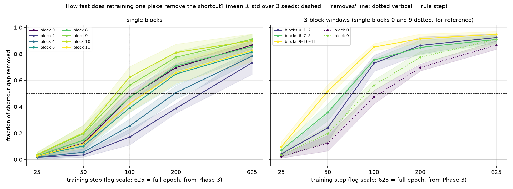

# BUDGET REPORT: Phase 3b (retraining budget)

**Status: FINISHED.** 33 runs, no crashes. The rule was committed before any run (`a766093`, "Pre-register Phase 3b").
Every number comes from `results/retrain_budget/seed{0,1,2}.json`, `results/retrain/` (step 625) and `results/swap/`,
via the tables `src/report.py` wrote into [RESULTS.md](RESULTS.md) ("Phase 3b"), or from `logs/run_budget.log`.
Per-seed values are in seed order 0/1/2.

**Question:** in Phase 3 the full epoch (625 steps) removed the shortcut whichever block we retrained. Do late blocks fix it *faster*?
**Fraction removed** = (gap of the start model − gap now) / gap of the start model. 1 = shortcut gone.

## 1. The rule
| rule | result | per seed |
|---|---|---|
| "location matters for fixing": at step 100, mean of single blocks {9,10,11} beats mean of {0,2,4} by ≥ 0.20 | **FAIL** | P/F/F: difference 0.392/0.199/0.121 |

Seed 1 missed by 0.001, seed 2 clearly. The verdict is a fail either way.

## 2. What it means, in plain words
- **Late blocks are somewhat faster, but not by much, and not in every seed.** At step 100, the mean of blocks 9-11 was 0.621/0.506/0.483,
  against 0.228/0.307/0.362 for blocks 0, 2, 4.
- **The early group is pulled up by block 0.** Block 0 is as fast as block 8 (step 100: 0.473 vs 0.470 mean). Blocks 2 and 4
  are the slowest of all (0.171 and 0.254). So the order isn't simply "later = faster". It goes slow at 2, rises to a peak at block 10 (0.624), then drops at block 11 (0.423).
- **Block 11 is slow to retrain**, even though the swaps showed its attention carries most of block 11's effect. Another case of
  "where it's stored is not where it's easiest to fix".
- **3-block windows show a clearer late advantage** (not a pre-registered rule, just a description): at step 50, 9-10-11
  removed 0.493/0.585/0.472, against 0.091/0.308/0.321 for 0-1-2 and 0.270/0.375/0.424 for 6-7-8. By step 100 the gap between windows shrinks
  (0.851 vs 0.729 / 0.753 mean).
- **The swap–retrain order agreement (Spearman, 8 single blocks) is unstable.** Seed 0 is 0.976–1.000 at every early step. Seed 1 falls
  from 0.881 (step 25) to 0.548 (step 200). Seed 2 goes 0.238 → 0.905. With only 8 blocks, one block changing place moves it a lot.
- **No cost to normal accuracy at any step:** acc(none) stays between 0.867 and 0.881 in every run and step (start models 0.874/0.874/0.876).
- **Steps 25 and 50 show little** (at step 25 the mean is ≤ 0.10 for every set). Part of this is the warmup: the learning rate only reaches full
  size at step 38.

## 3. Checks
- **Steps 1-200 are exactly the start of the Phase 3 runs:** the training loss at steps 50/100/150/200 matches Phase 3 with zero difference
  in all 132 comparisons. So "step 625 = Phase 3" is a fair last point on the same curve.
- Frozen weights were checked to be bit-identical after every run.
- Smoke test (seed 0, 9-10-11, 20 steps): passed, `logs/smoke_budget.log`.

## 4. VRAM and time: one rule break, fixed during the run
- The `del m` + `empty_cache()` fix from the night-2 report is in `src/retrain.py`.
- **New problem found:** the evaluations in the middle of training (batch 64) left PyTorch's memory cache in small pieces, so *reserved* memory rose.
  Memory actually in use was never above 2.40 GiB.
  - Run seed 0 / block 0: reserved 3.70 GiB (under the limit). I stopped the driver and added a cache clear *after* each evaluation.
  - Run seed 0 / block 2: reserved **4.21 GiB, over the 4.5 GB (4.19 GiB) limit.** I stopped again and added a cache clear *before* each evaluation too.
  - After that, every run stayed at or below 3.44 GiB reserved (the 0-1-2 windows).
  - Both stops are noted in `logs/run_budget.log`. The two runs were kept as measured. Cache clearing doesn't change any numbers (the loss check above
    includes those runs).
- Time: 57.5 min for the 33 runs. Training was only 19-42 s per run. Evaluation took about 80 s per run (4 × 4,000 reviews).

## 5. Caveats
- One learning rate and one schedule. The early steps are inside the warmup, so "speed" here partly means "speed at a tiny learning rate".
- The rule compares two groups of 3 blocks. Block 0's odd speed decides much of it.
- The retrain data are the same 10k reviews the models were trained on, with the names re-randomized.

## 6. Suggested next steps (not started)
1. Why is block 0 fast? It's the first place the name tokens are mixed with the rest of the review. Worth a look
   before reading too much into "late is better".
2. LoRA (HANDOFF_LORA.md), as planned.

## Files
`src/retrain.py --budget`, `src/run_budget.py` (driver), `src/train.py` (new options `stop_at`, `on_step`; old phases unchanged),
`src/report.py` (Phase 3b section). Results: `results/retrain_budget/`, per-run config and loss in `runs/retrain_budget/*/`.
Re-run: `.venv\Scripts\python src\run_budget.py` (skips finished runs).
