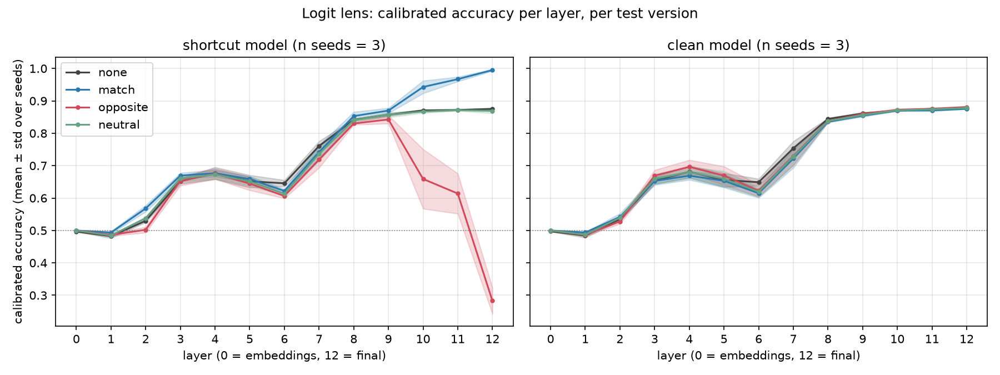
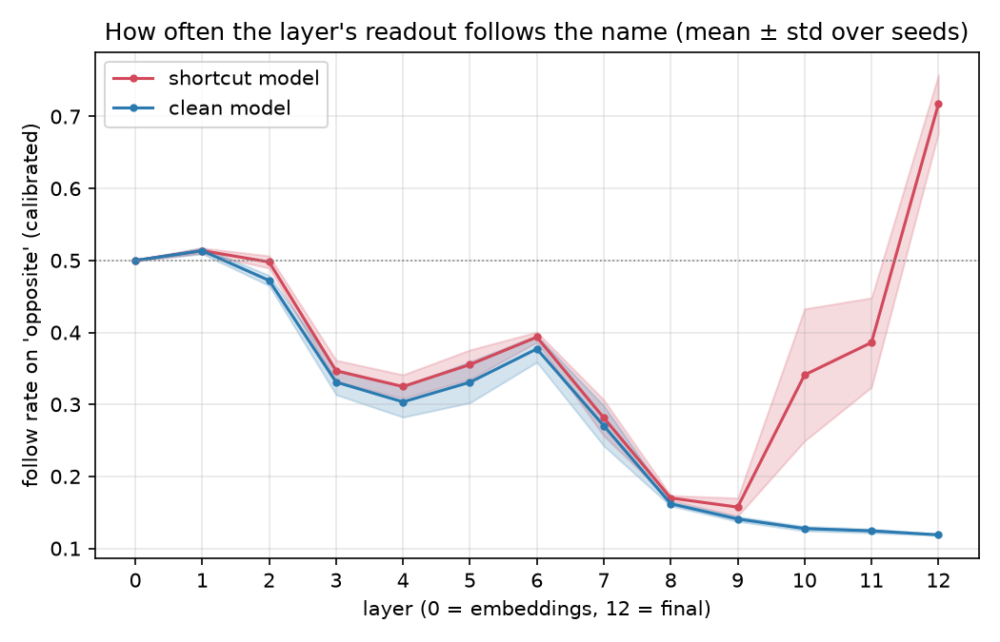

# MORNING REPORT: overnight pilot run (13–14 Oct 2026)

**Status: FINISHED. All 6 runs passed their checks; the logit lens, figures and RESULTS.md are done.**
No fallback was needed (prevalence stayed at 5%), there were no crashes or out-of-memory errors, and the effective batch stayed at 16.
Every number below is copied from `RESULTS.md`, `results/*.json` or `logs/run_pilot.log`. Nothing is typed from memory.

## Short answer to the pilot question
**Yes, GPT-2 "overthinks" the name shortcut.** On "opposite" reviews (where the name points to the wrong
sentiment), the true sentiment is readable up to **layer 9**. Calibrated accuracy there is 0.843 ± 0.013, almost the
same as 0.857 on reviews with no name. Then **layers 10–12 flip it**: 0.659 at layer 10, 0.614 at layer 11 and 0.283 at the final layer.
The clean twin shows no drop at all: its "opposite" line sits on top of "none" at every layer.
This also fits Eshuijs et al.'s "label heads in layers 10–11".

## What finished
| run | acc none | acc match | acc opposite | gap none−opp | checks | wall time (s) | peak VRAM (GiB) |
|---|---|---|---|---|---|---|---|
| shortcut_seed0 | 0.874 | 0.998 | 0.228 | 0.646 | task PASS, shortcut PASS | 582 | 3.56 |
| shortcut_seed1 | 0.874 | 0.997 | 0.249 | 0.626 | task PASS, shortcut PASS | 563 | 3.57 |
| shortcut_seed2 | 0.876 | 0.992 | 0.335 | 0.541 | task PASS, shortcut PASS | 563 | 3.57 |
| clean_seed0 | 0.876 | 0.876 | 0.882 | -0.007 | task PASS, no-shortcut PASS | 568 | 3.58 |
| clean_seed1 | 0.875 | 0.876 | 0.882 | -0.007 | task PASS, no-shortcut PASS | 563 | 3.57 |
| clean_seed2 | 0.875 | 0.876 | 0.880 | -0.005 | task PASS, no-shortcut PASS | 563 | 3.57 |

Peak VRAM is GPU memory actually used by PyTorch (allocated); the reserved figure was 3.89 GiB in the smoke test.
All runs stayed under the 4.5 GB limit. The whole driver took 5,059 s (about 84 min).

**Base GPT-2 (before fine-tuning) name check:** the mean score differs by −0.011 between names A and B, while
scores vary by about 0.55 across reviews. So the base model has essentially no A-vs-B preference. N differs a bit
more from A (−0.070) and from B (−0.060), which is still small next to the 0.55 spread.

**Early exit** (shortcut model): stopping at layer 9 is the best single layer for "opposite" in all 3 seeds.
Accuracy on "opposite" rises from 0.228/0.248/0.335 at the final layer to 0.861/0.835/0.833 at layer 9.
It costs only 0.014/0.023/0.017 accuracy on "none". (Caveat: this uses the calibrated readout, which needs a threshold
taken from the "none" set.)

**Lock-in layer** (shortcut model): mean 8.66 on "opposite" vs 5.14 on "none". So reviews with the misleading name
settle their final answer about 3.5 layers later. In the clean model, all four versions are about 5.1–5.3.

## Things to check or know (honest list)
1. **The automatic reading says "takeover layer 12", but the figure shows the drop starting at layer 10.** The rule
   in `report.py`, which I wrote before seeing any results, needs the gap to stay at or above half its final size (0.593 → 0.296).
   The gap at layers 10 and 11 (about 0.21 and 0.26) is just under that bar, so the rule names layer 12. I did **not**
   change the rule after seeing the data. Please decide which definition you want, and I'll regenerate RESULTS.md from it.
2. **Seeds disagree at layers 10–11.** "Opposite" accuracy at layer 10 is 0.758/0.681/0.537 across the three seeds. All
   three agree at layer 9 and at layer 12. So *where between 10 and 12* the shortcut takes over varies by seed; *that*
   it happens late does not.
3. **"Match" climbs above "none" from layer 10 on** (0.943 at layer 10, 0.995 at layer 12). So the name signal is
   added in those same layers in both directions, not only when it misleads.
4. **There's a dip at layer 6 in every model**, clean ones included. It's not shortcut-related; worth a look later.
5. **Lock-in is "undefined" for some reviews** (up to 60 of 2,000). The calibrated readout at layer 12 uses the median
   threshold, which isn't exactly 0, so it can disagree with the model's real answer. I left those reviews out and
   counted them in RESULTS.md. This was my interpretation of the spec; tell me if you'd rather use the layer-12
   calibrated readout as "final answer".
6. **The logit-lens step was slow for two runs for no clear reason.** shortcut_seed1 took about 11 min and clean_seed2
   about 6.5 min, vs about 1 min for the others (timestamps in the log). Maybe the laptop throttled or another app used
   the GPU. It doesn't change the results: evaluation is deterministic, with no randomness.

## Decisions I made that the spec didn't fix (all recorded in files)
- **Names:** A = Tavin Morrell, B = **Dorvan Hastrow**, N = Corwin Halvey, 4 GPT-2 tokens each. My first B,
  "Delvin Hastrow", failed my own check because "Delvin" already appears in 2 IMDB test reviews, so I swapped it.
  `make_data.py` now asserts that no part of any name occurs anywhere in IMDB.
- **Named training reviews are split evenly by label** (250 positive with A, 250 negative with B). In the clean twin,
  A/B is a coin flip: A 249, B 251, and 119 of the A's are on positive reviews (`data/manifest.json`).
- **Where the name goes:** before any sentence, or after the last one only if that sentence is complete (reviews
  are cut at ~100 tokens, so the last sentence is often unfinished).
- **AdamW weight decay = 0.01**, PyTorch's default; the spec didn't give one (`configs/pilot.yaml`).
- **Loss:** a two-way cross-entropy over the " negative"/" positive" logits. Both label words are single GPT-2
  tokens (4633 and 3967), so no change of label words was needed.
- **A sanity check inside the logit lens:** for every batch, the layer-12 lens score must equal the model's real final
  logits. It passed for all runs.
- **The driver runs fully offline** (HF_HUB_OFFLINE / HF_DATASETS_OFFLINE). Rebuilding the data offline gives
  byte-identical files.

## Git
- Commit `beb8f30`: Milestone 2 (data + shortcut_seed0 passes).
- Commit for Milestone 3 (pilot results): figures, RESULTS.md, all results JSON, this report. Weights, data
  and caches aren't committed. Nothing was pushed (there's no remote).

## Reproduce
`.venv\Scripts\python src\make_data.py` then `.venv\Scripts\python src\run_pilot.py`. The driver resumes,
skipping finished runs. `src\report.py` alone regenerates RESULTS.md and the figures.

## What I suggest next
1. Settle the "takeover layer" definition (item 1). One option is "first layer where 'opposite' falls more than X below 'none'".
2. Since layers 10–11 are where it happens, the natural next step is the per-head analysis, as in Halawi and
   Eshuijs: which attention heads in layers 10–11 write the name's answer. That's out of scope until you say go.
3. Check the layer-6 dip and the N-vs-A/B difference in the base model, both small.
