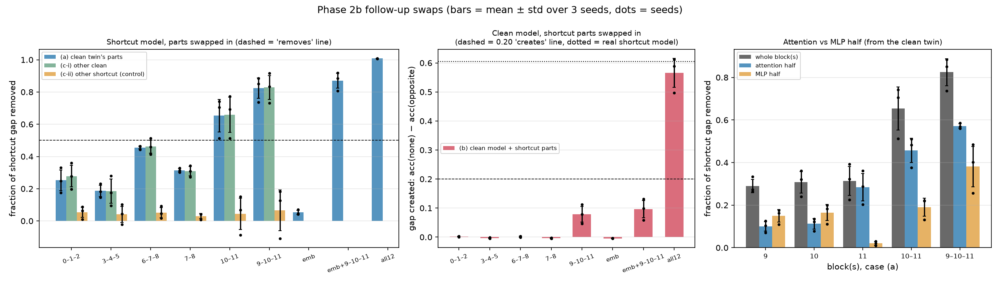
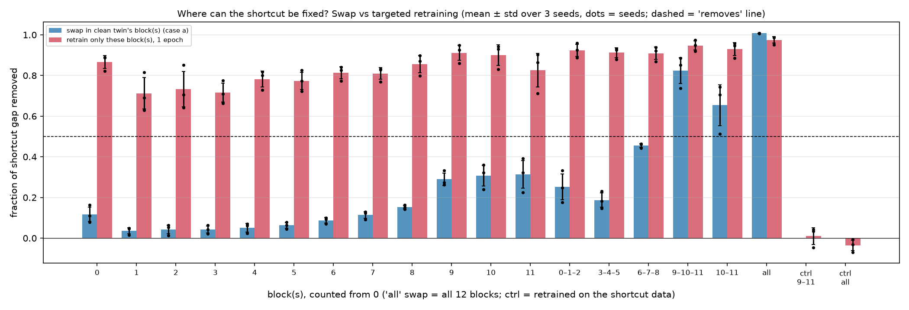

# NIGHT 2 REPORT: Phase 2b (follow-up swaps) + Phase 3 (targeted retraining)

**Status: FINISHED, no crashes.** The rules were committed before any run (`31eca36`, "Pre-register Phase 2b + Phase 3 rules").
Sonu stopped the job by hand once (15 Oct 22:56, during seed 1's first retrain run). It was restarted 16 Oct 00:00
and resumed from saved results. The one run that was cut off (seed 1, block 0) was redone from scratch.
It is all logged in `logs/run_night2.log`.

Every number below comes from `results/swap/`, `results/swap2/` and `results/retrain/` (`seed{0,1,2}.json`), via the
tables `src/report.py` wrote into [RESULTS.md](RESULTS.md), or from `logs/run_night2.log`. Per-seed values are in
seed order 0/1/2.

Words used:
- **gap** = acc(none) − acc(opposite), i.e. how much a misleading name hurts. Unswapped shortcut models: 0.646/0.626/0.541.
- **fraction removed** = (unswapped gap − gap after the edit) / unswapped gap. 1 = shortcut fully gone, 0 = no change.
- **swap** = copy weights from another model in, no training. **retrain** = train only some blocks on clean data for 1 epoch.

## 1. The rules, one by one

| rule | result | per seed | what it means |
|---|---|---|---|
| Phase 2: single block swap **removes** (case a) | FAIL, every block 0–11 | F/F/F | No single block swapped from the clean twin halves the gap. Best: block 9, 10 or 11, removing about a quarter to a third. |
| Phase 2: blocks 10-11 **removes** (a and c-i) | PASS | P/P/P | Swapping the last two blocks from any clean model removes most of the shortcut. |
| Phase 2: blocks 9-10-11 **removes** (a and c-i) | PASS | P/P/P | Same, a bit more (fraction removed 0.885/0.851/0.738). |
| Phase 2: **not just breaking** (c-ii, all 14 block sets) | PASS | P/P/P | Swapping in another *shortcut* model's blocks keeps the shortcut. So the removals are real, not damage. |
| Phase 2: **creates** (case b, all 14 block sets) | FAIL | F/F/F | Putting the shortcut model's late blocks into the clean model does not create the shortcut. |
| 2b-a: windows 0-1-2, 3-4-5, 6-7-8, 7-8 **remove** (a) | FAIL | F/F/F | No early or middle window halves the gap. 6-7-8 comes closest (fraction 0.463/0.443/0.461). |
| 2b-a: **blocks 9-11 are late-specific** (≥ 2× best other window) | **FAIL** | F/F/F | Close miss: ratios 1.91/1.92/1.60. The best other window is always 6-7-8. Late blocks matter most, but not twice as much as 6-8. |
| 2b-b: **name embeddings carry part of the shortcut** (case b) | **FAIL** | F/F/F | Adding the name-token embeddings to blocks 9-11 adds only 0.020/0.019/0.012 of gap (needed 0.10). Name embeddings alone do nothing. |
| 2b-b: all12 **creates** (case b) | PASS | P/P/P | Putting all 12 shortcut blocks into the clean model (keeping clean embeddings, ln_f, lm_head) recreates the shortcut: gap 0.612/0.588/0.496. |
| 2b-b: all12 and emb_names+9-10-11 **remove** (a) | PASS | P/P/P | As expected, given 9-10-11 alone already passes. |
| 2b-c: block 11: **attention carries it** | PASS | P/P/P | Block 11's attention half alone does 0.89/0.92/0.90 of what the whole block does. Its MLP half does almost nothing (0.03/0.08/0.09). |
| 2b-c: blocks 9, 10, 10-11, 9-10-11: one half carries it | FAIL → **"both needed"** | — | Neither half reaches 2/3 in all seeds. For 10-11 and 9-10-11, attention reaches it in seeds 1 and 2 but not seed 0 (shares 0.65/0.72/0.74 and 0.64/0.69/0.76). |
| 2b-c: attn:9-10-11 **removes** (a) | PASS | P/P/P | The attention halves of blocks 9-11 alone halve the gap (gap 0.278/0.259/0.238). The MLP halves alone do not. |
| 2b-c: halves **not just breaking** (c-ii) | PASS | P/P/P | Swapping the same halves from another shortcut model keeps the shortcut. |
| 3: **GATE**, retrain "all" on seed 0 | PASS | — | Gap 0.646 → 0.031 (limit 0.323). Phase 3 went ahead. |
| 3: retraining each set **removes** (all 18 sets: single blocks 0..11, 5 windows, all) | **PASS for every set** | P/P/P | Even retraining **block 0 alone** removes it (fraction 0.890/0.888/0.822). The weakest is block 1 (0.815/0.691/0.629), still well past the 0.5 line. |
| 3: controls (retrain on shortcut data) **keep the shortcut** | PASS | P/P/P | 9-10-11: fraction −0.047/0.043/0.034. all: −0.070/−0.006/−0.032. So the fix comes from the clean data, not from the training itself. |
| 3: **swap and retrain agree on where to fix it** (Spearman ≥ 0.6) | PASS | 0.825/0.881/0.839 | Ranked by how well they work, single blocks come out in a similar order for both methods: late blocks best, early ones weakest. |

## 2. What it means, in plain words
- **Where the shortcut is stored (swaps):** mostly in the last blocks, 9-11, and inside block 11 mainly in **attention**.
  That fits Eshuijs et al.'s "label heads" in blocks 10-11 and the logit lens flip at blocks 9-11. But it's not *only*
  there: blocks 6-8 swapped together remove almost half, which is why the "late-specific" rule just failed.
- **The shortcut needs the whole stack to exist.** Late blocks alone can't create it in a clean model. All 12 blocks can.
  The embeddings play no part: neither the name rows nor the whole embedding matrix. So last night's guess in
  SWAP_REPORT.md ("the name signal sits in the embeddings") is **wrong**. The missing part is in blocks 0-8 together.
- **Where it can be fixed (retraining):** almost **anywhere**. One epoch of clean data on any single block, even block 0,
  removes 63-95% of the gap (per seed and block). Late blocks fix it a bit better (block 9: 0.949/0.925/0.860), so the *ranking* agrees
  with the swaps (Spearman PASS). But the *size* is very different: swapping block 0 removes about 12%, retraining it removes about 87%.
  This is the "where you find it is not where you must fix it" point (Hase et al.; "Does Localization Inform
  Unlearning?"). Here, localization tells you the best place, but not the only place.

## 3. Surprises
1. **Retraining any single block works.** I expected only late blocks to work. A likely reason (not tested): the clean
   data shows the names with random labels, so it directly teaches "the name means nothing". Any block that can change
   what the model does with the name tokens can learn that.
2. **Retraining "all" costs a little normal accuracy.** acc(none) went 0.874/0.874/0.876 → 0.872/0.866/0.862. That's a drop of up to
   0.014, still within the 0.02 rule. It's the largest cost of any set.
3. **"Late-specific" missed by a small margin** (1.60–1.92 vs 2.0). It's a real fail under the rule, but a close one.
4. **Attention vs MLP isn't the same in every late block.** Block 11 is attention-only. Blocks 9 and 10 need both halves.

## 4. Wall time and VRAM
- **Phase 2b:** 126 swaps (42 per seed) in 97.9 min. Peak VRAM allocated 1.42 GiB.
- **Phase 3:** 60 retrain runs, 2.75 h summed over runs including evaluation. Training alone took 66–209 s per run
  (single block 11 fastest, "ctrl_shortcut:all" slowest).
- **Clock time:** first process 15 Oct 20:20–22:56 (stopped by hand). Second process 16 Oct 00:00–01:53 (1.88 h).
- **VRAM rule (stay under 4.5 GB): broken in 4 runs.** The memory the tensors actually used peaked at 3.62 GiB (3.9 GB),
  which is under the limit. But PyTorch's *reserved* memory (memory it keeps for reuse) grew from run to run inside
  one process. It reached 4.42 GiB in seed 1 and 4.91 GiB in seed 2, in the "all" and "ctrl_shortcut:all" runs. That's 4.7 GB and 5.3 GB, over the limit.
  In those runs, evaluation took 160–164 s instead of about 45 s. My guess is that the GPU spilled into slower shared
  system memory. This should not change any numbers, only make them slower.
- **Bug found (not fixed, results unaffected):** in `src/retrain.py`, when a seed's starting model is evaluated, a GPU
  copy stays alive (the variable `m`, about 0.46 GiB). You can see it in the cost table: seed 2's runs, and seed 0's gate runs,
  show about 0.46 GiB more than the same runs elsewhere. It isn't used for anything. Fix for next time: `del m`, then
  `torch.cuda.empty_cache()` between runs. That would also deal with the reserved-memory growth.

## 5. Caveats
- One epoch of retraining is a single setting. We didn't test fewer steps. With fewer steps the blocks might separate more.
- The retrain uses `train_clean.jsonl`, the same 10k reviews the models were trained on (with names re-randomized).
- Swaps and retraining are compared on fraction removed, but they're very different interventions (copying weights vs
  learning). Spearman only checks the *order* of blocks.

## 6. Suggested next steps (not started)
1. A "budget" curve: retrain single blocks for 20/50/100/200 steps, to see whether late blocks fix it *faster*.
   That's probably where location matters.
2. LoRA (see HANDOFF_LORA.md). Since embeddings play no part here, LoRA (which doesn't train embeddings) should still
   be able to learn the shortcut.
3. Fix the VRAM issue above before the next long run.

## Files
`src/swap.py --phase2b`, `src/retrain.py`, `src/run_night2.py`, `src/report.py`, `src/train.py` (new options
`init_from` and `trainable_blocks`; the pilot behaves as before). Results are in `results/swap2/`, `results/retrain/`, and
`runs/retrain/*/` (config + loss log per run, no weights). The smoke test is in `results/smoke/` and `logs/smoke_night2.log`. Figures:
`figures/swap2_map.png`, `figures/retrain_map.png`. Re-run everything: `.venv\Scripts\python src\run_night2.py`
(it skips finished work).
