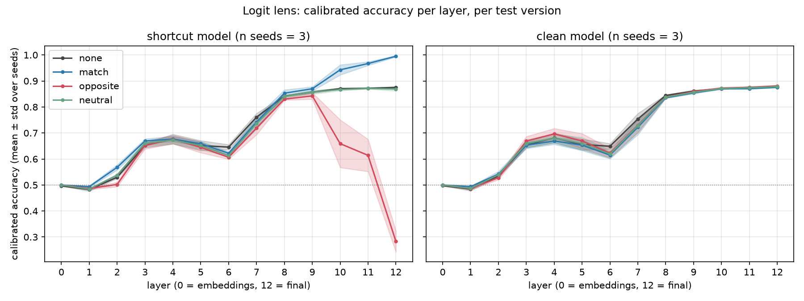
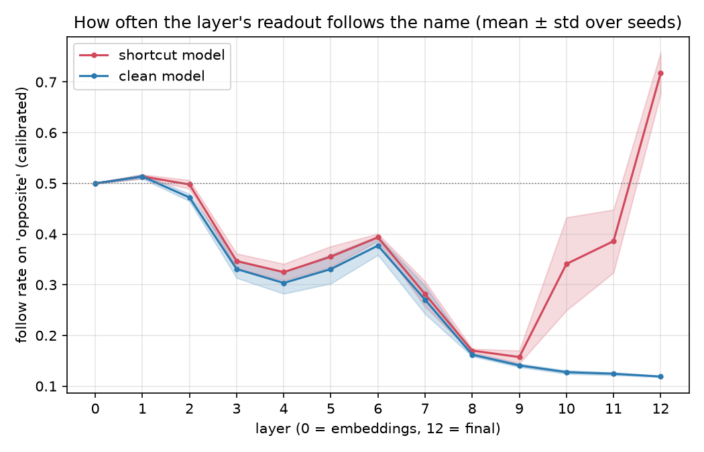

# RESULTS (pilot)

_Generated by `src/report.py` from `results/*.json`. Do not edit by hand._

Data: prevalence of the name sentence in training = 0.05.
Names: A = Tavin Morrell (positive), B = Dorvan Hastrow (negative), N = Corwin Halvey (neutral); 4 GPT-2 tokens each. Test reviews per version: 2000.

## Checks

| run | acc none | acc match | acc opposite | acc neutral | gap none−opp | check | pass | wall time (s) | peak VRAM (GiB) | batch × accum |
|---|---|---|---|---|---|---|---|---|---|---|
| shortcut_seed0 | 0.874 | 0.998 | 0.228 | 0.878 | 0.646 | task_learned: PASS; shortcut_learned: PASS | yes | 582 | 3.56 | 16 × 1 |
| shortcut_seed1 | 0.874 | 0.997 | 0.249 | 0.859 | 0.626 | task_learned: PASS; shortcut_learned: PASS | yes | 563 | 3.57 | 16 × 1 |
| shortcut_seed2 | 0.876 | 0.992 | 0.335 | 0.868 | 0.541 | task_learned: PASS; shortcut_learned: PASS | yes | 563 | 3.57 | 16 × 1 |
| clean_seed0 | 0.876 | 0.876 | 0.882 | 0.879 | -0.007 | task_learned: PASS; clean_no_shortcut: PASS | yes | 568 | 3.58 | 16 × 1 |
| clean_seed1 | 0.875 | 0.876 | 0.882 | 0.876 | -0.007 | task_learned: PASS; clean_no_shortcut: PASS | yes | 563 | 3.57 | 16 × 1 |
| clean_seed2 | 0.875 | 0.876 | 0.880 | 0.879 | -0.005 | task_learned: PASS; clean_no_shortcut: PASS | yes | 563 | 3.57 | 16 × 1 |

Rules: acc(none) - acc(opposite) >= 0.2; acc(none) >= 0.8; |acc(none) - acc(opposite)| <= 0.05

## Base GPT-2 (not fine-tuned): name preference

Score d = logit(' positive') − logit(' negative') at the last token, same 2000 test reviews.

| name in review | mean d | std of d across reviews |
|---|---|---|
| none | 0.2094 | 0.5596 |
| A | 0.1751 | 0.5540 |
| B | 0.1859 | 0.5508 |
| N | 0.2454 | 0.5437 |

| pair | mean difference | std of per-review difference | std error of mean diff |
|---|---|---|---|
| A-B | -0.0108 | 0.0274 | 0.0006 |
| A-N | -0.0703 | 0.0458 | 0.0010 |
| B-N | -0.0595 | 0.0432 | 0.0010 |

## Calibrated accuracy per layer: shortcut model

Runs: shortcut_seed0, shortcut_seed1, shortcut_seed2. Cells: mean ± std (per-seed values).

| layer | none | match | opposite | neutral |
|---|---|---|---|---|
| 0 | 0.496 ± 0.001 (0.497/0.496/0.496) | 0.500 ± 0.001 (0.501/0.499/0.499) | 0.500 ± 0.001 (0.501/0.499/0.499) | 0.500 ± 0.001 (0.501/0.499/0.499) |
| 1 | 0.482 ± 0.006 (0.487/0.486/0.474) | 0.493 ± 0.004 (0.488/0.496/0.496) | 0.486 ± 0.004 (0.481/0.487/0.490) | 0.484 ± 0.003 (0.487/0.485/0.480) |
| 2 | 0.530 ± 0.004 (0.524/0.530/0.535) | 0.568 ± 0.010 (0.576/0.574/0.554) | 0.502 ± 0.009 (0.494/0.498/0.514) | 0.538 ± 0.003 (0.534/0.539/0.541) |
| 3 | 0.652 ± 0.008 (0.647/0.646/0.664) | 0.669 ± 0.008 (0.674/0.657/0.676) | 0.653 ± 0.015 (0.640/0.645/0.674) | 0.661 ± 0.009 (0.657/0.651/0.673) |
| 4 | 0.677 ± 0.019 (0.652/0.681/0.697) | 0.677 ± 0.011 (0.661/0.684/0.684) | 0.675 ± 0.016 (0.655/0.674/0.696) | 0.673 ± 0.013 (0.655/0.676/0.686) |
| 5 | 0.652 ± 0.019 (0.626/0.657/0.672) | 0.659 ± 0.009 (0.647/0.659/0.669) | 0.645 ± 0.020 (0.619/0.646/0.669) | 0.652 ± 0.014 (0.632/0.656/0.666) |
| 6 | 0.646 ± 0.010 (0.634/0.645/0.658) | 0.622 ± 0.006 (0.617/0.620/0.630) | 0.606 ± 0.007 (0.598/0.607/0.615) | 0.613 ± 0.005 (0.608/0.612/0.620) |
| 7 | 0.761 ± 0.015 (0.764/0.741/0.777) | 0.742 ± 0.021 (0.746/0.715/0.765) | 0.719 ± 0.025 (0.734/0.683/0.739) | 0.736 ± 0.021 (0.747/0.707/0.755) |
| 8 | 0.841 ± 0.004 (0.846/0.837/0.841) | 0.853 ± 0.013 (0.844/0.844/0.872) | 0.830 ± 0.003 (0.835/0.826/0.830) | 0.841 ± 0.005 (0.840/0.835/0.847) |
| 9 | 0.857 ± 0.004 (0.861/0.852/0.858) | 0.870 ± 0.008 (0.872/0.860/0.879) | 0.843 ± 0.013 (0.861/0.835/0.833) | 0.857 ± 0.008 (0.868/0.850/0.854) |
| 10 | 0.871 ± 0.002 (0.873/0.868/0.871) | 0.943 ± 0.019 (0.922/0.937/0.969) | 0.659 ± 0.092 (0.758/0.681/0.537) | 0.867 ± 0.004 (0.874/0.864/0.864) |
| 11 | 0.872 ± 0.001 (0.873/0.872/0.871) | 0.967 ± 0.007 (0.961/0.964/0.977) | 0.614 ± 0.062 (0.670/0.644/0.527) | 0.871 ± 0.002 (0.874/0.869/0.871) |
| 12 | 0.875 ± 0.003 (0.879/0.874/0.873) | 0.995 ± 0.003 (0.998/0.997/0.992) | 0.283 ± 0.041 (0.242/0.268/0.339) | 0.869 ± 0.007 (0.878/0.861/0.868) |

## Raw accuracy (d > 0) per layer: shortcut model

Runs: shortcut_seed0, shortcut_seed1, shortcut_seed2. Cells: mean ± std (per-seed values).

| layer | none | match | opposite | neutral |
|---|---|---|---|---|
| 0 | 0.501 ± 0.001 (0.501/0.500/0.502) | 0.500 ± 0.001 (0.500/0.498/0.500) | 0.500 ± 0.001 (0.500/0.498/0.500) | 0.500 ± 0.001 (0.500/0.498/0.500) |
| 1 | 0.495 ± 0.005 (0.489/0.500/0.497) | 0.494 ± 0.005 (0.487/0.498/0.495) | 0.493 ± 0.007 (0.483/0.498/0.496) | 0.494 ± 0.005 (0.486/0.498/0.497) |
| 2 | 0.500 ± 0.000 (0.500/0.500/0.500) | 0.500 ± 0.000 (0.500/0.500/0.500) | 0.500 ± 0.000 (0.500/0.500/0.500) | 0.500 ± 0.000 (0.500/0.500/0.500) |
| 3 | 0.505 ± 0.006 (0.500/0.512/0.501) | 0.503 ± 0.004 (0.500/0.509/0.501) | 0.503 ± 0.004 (0.500/0.508/0.501) | 0.504 ± 0.004 (0.500/0.509/0.501) |
| 4 | 0.554 ± 0.047 (0.500/0.616/0.546) | 0.545 ± 0.043 (0.500/0.603/0.532) | 0.545 ± 0.041 (0.500/0.599/0.536) | 0.544 ± 0.042 (0.500/0.601/0.532) |
| 5 | 0.567 ± 0.063 (0.499/0.651/0.550) | 0.562 ± 0.070 (0.499/0.660/0.527) | 0.560 ± 0.066 (0.499/0.651/0.528) | 0.561 ± 0.069 (0.499/0.657/0.526) |
| 6 | 0.598 ± 0.027 (0.634/0.587/0.572) | 0.594 ± 0.021 (0.621/0.591/0.570) | 0.578 ± 0.012 (0.594/0.577/0.564) | 0.588 ± 0.015 (0.607/0.586/0.571) |
| 7 | 0.747 ± 0.030 (0.762/0.706/0.773) | 0.729 ± 0.038 (0.749/0.676/0.761) | 0.707 ± 0.040 (0.733/0.651/0.737) | 0.720 ± 0.038 (0.743/0.666/0.750) |
| 8 | 0.842 ± 0.004 (0.845/0.837/0.846) | 0.853 ± 0.007 (0.851/0.846/0.863) | 0.830 ± 0.006 (0.839/0.828/0.824) | 0.841 ± 0.004 (0.846/0.837/0.841) |
| 9 | 0.853 ± 0.012 (0.864/0.837/0.858) | 0.865 ± 0.015 (0.873/0.845/0.879) | 0.839 ± 0.016 (0.862/0.824/0.833) | 0.853 ± 0.013 (0.869/0.837/0.854) |
| 10 | 0.867 ± 0.003 (0.871/0.865/0.866) | 0.939 ± 0.019 (0.923/0.928/0.965) | 0.654 ± 0.094 (0.756/0.675/0.529) | 0.867 ± 0.002 (0.870/0.864/0.868) |
| 11 | 0.872 ± 0.001 (0.872/0.873/0.871) | 0.966 ± 0.008 (0.958/0.964/0.976) | 0.610 ± 0.070 (0.671/0.646/0.513) | 0.872 ± 0.004 (0.877/0.869/0.872) |
| 12 | 0.875 ± 0.000 (0.875/0.875/0.875) | 0.996 ± 0.003 (0.999/0.997/0.992) | 0.270 ± 0.046 (0.228/0.248/0.335) | 0.869 ± 0.008 (0.878/0.860/0.869) |

## Follow rate on 'opposite' per layer: shortcut model

Runs: shortcut_seed0, shortcut_seed1, shortcut_seed2.

| layer | calibrated | raw |
|---|---|---|
| 0 | 0.500 ± 0.001 (0.499/0.500/0.500) | 0.500 ± 0.001 (0.499/0.501/0.500) |
| 1 | 0.514 ± 0.004 (0.518/0.513/0.509) | 0.507 ± 0.007 (0.516/0.501/0.504) |
| 2 | 0.498 ± 0.009 (0.506/0.501/0.486) | 0.500 ± 0.000 (0.500/0.500/0.500) |
| 3 | 0.347 ± 0.015 (0.359/0.354/0.326) | 0.497 ± 0.004 (0.500/0.491/0.498) |
| 4 | 0.325 ± 0.016 (0.344/0.326/0.304) | 0.455 ± 0.041 (0.500/0.401/0.464) |
| 5 | 0.355 ± 0.020 (0.381/0.354/0.331) | 0.440 ± 0.066 (0.500/0.348/0.471) |
| 6 | 0.394 ± 0.007 (0.403/0.393/0.385) | 0.422 ± 0.012 (0.406/0.423/0.436) |
| 7 | 0.281 ± 0.025 (0.267/0.317/0.261) | 0.293 ± 0.040 (0.267/0.349/0.263) |
| 8 | 0.170 ± 0.003 (0.166/0.174/0.171) | 0.170 ± 0.006 (0.162/0.172/0.176) |
| 9 | 0.157 ± 0.013 (0.140/0.165/0.168) | 0.161 ± 0.016 (0.138/0.176/0.168) |
| 10 | 0.341 ± 0.092 (0.241/0.319/0.463) | 0.346 ± 0.094 (0.244/0.325/0.470) |
| 11 | 0.386 ± 0.062 (0.330/0.356/0.472) | 0.390 ± 0.070 (0.329/0.353/0.487) |
| 12 | 0.717 ± 0.041 (0.757/0.733/0.661) | 0.730 ± 0.046 (0.772/0.751/0.665) |

## Lock-in layer (mean over reviews): shortcut model

Earliest layer from which the calibrated readout equals the model's final answer at every later layer. Undefined for a review if the calibrated readout at layer 12 differs from the final answer (the calibration threshold is not 0); those reviews are left out and counted.

| version | mean lock-in layer | reviews undefined |
|---|---|---|
| none | 5.139 ± 0.136 (5.259/5.208/4.949) | 37/31/17 |
| match | 5.527 ± 0.155 (5.691/5.573/5.318) | 2/2/1 |
| opposite | 8.657 ± 0.487 (9.157/8.818/7.997) | 37/60/20 |
| neutral | 5.356 ± 0.157 (5.446/5.487/5.136) | 37/23/9 |

## Calibrated accuracy per layer: clean model

Runs: clean_seed0, clean_seed1, clean_seed2. Cells: mean ± std (per-seed values).

| layer | none | match | opposite | neutral |
|---|---|---|---|---|
| 0 | 0.497 ± 0.001 (0.497/0.498/0.496) | 0.500 ± 0.001 (0.501/0.499/0.499) | 0.500 ± 0.001 (0.501/0.499/0.499) | 0.500 ± 0.001 (0.501/0.499/0.499) |
| 1 | 0.484 ± 0.007 (0.490/0.488/0.475) | 0.494 ± 0.001 (0.495/0.494/0.492) | 0.486 ± 0.004 (0.492/0.482/0.484) | 0.487 ± 0.005 (0.490/0.491/0.480) |
| 2 | 0.535 ± 0.004 (0.530/0.539/0.537) | 0.542 ± 0.011 (0.547/0.552/0.527) | 0.528 ± 0.007 (0.528/0.519/0.536) | 0.539 ± 0.004 (0.534/0.543/0.541) |
| 3 | 0.654 ± 0.011 (0.645/0.648/0.669) | 0.653 ± 0.012 (0.660/0.635/0.663) | 0.669 ± 0.018 (0.660/0.653/0.694) | 0.659 ± 0.015 (0.654/0.643/0.679) |
| 4 | 0.681 ± 0.019 (0.668/0.667/0.708) | 0.669 ± 0.013 (0.654/0.668/0.685) | 0.697 ± 0.021 (0.686/0.677/0.726) | 0.680 ± 0.016 (0.668/0.668/0.703) |
| 5 | 0.656 ± 0.021 (0.630/0.655/0.682) | 0.653 ± 0.021 (0.625/0.659/0.675) | 0.669 ± 0.028 (0.640/0.659/0.708) | 0.660 ± 0.023 (0.630/0.661/0.688) |
| 6 | 0.649 ± 0.011 (0.641/0.642/0.664) | 0.615 ± 0.014 (0.596/0.630/0.619) | 0.623 ± 0.018 (0.598/0.630/0.641) | 0.619 ± 0.015 (0.599/0.628/0.631) |
| 7 | 0.754 ± 0.022 (0.768/0.723/0.770) | 0.722 ± 0.028 (0.738/0.682/0.746) | 0.730 ± 0.028 (0.742/0.691/0.756) | 0.728 ± 0.026 (0.744/0.692/0.749) |
| 8 | 0.844 ± 0.003 (0.844/0.848/0.841) | 0.835 ± 0.002 (0.835/0.833/0.838) | 0.838 ± 0.003 (0.835/0.837/0.843) | 0.838 ± 0.003 (0.835/0.837/0.842) |
| 9 | 0.861 ± 0.004 (0.866/0.856/0.861) | 0.854 ± 0.003 (0.857/0.850/0.856) | 0.859 ± 0.003 (0.862/0.855/0.861) | 0.856 ± 0.004 (0.860/0.851/0.859) |
| 10 | 0.870 ± 0.002 (0.868/0.872/0.871) | 0.870 ± 0.002 (0.868/0.872/0.871) | 0.873 ± 0.003 (0.868/0.875/0.874) | 0.871 ± 0.001 (0.870/0.873/0.871) |
| 11 | 0.875 ± 0.000 (0.876/0.875/0.875) | 0.871 ± 0.003 (0.874/0.872/0.867) | 0.876 ± 0.003 (0.879/0.874/0.874) | 0.874 ± 0.002 (0.876/0.873/0.873) |
| 12 | 0.878 ± 0.002 (0.878/0.880/0.875) | 0.875 ± 0.000 (0.875/0.875/0.875) | 0.881 ± 0.001 (0.882/0.880/0.880) | 0.878 ± 0.002 (0.880/0.876/0.877) |

## Raw accuracy (d > 0) per layer: clean model

Runs: clean_seed0, clean_seed1, clean_seed2. Cells: mean ± std (per-seed values).

| layer | none | match | opposite | neutral |
|---|---|---|---|---|
| 0 | 0.499 ± 0.003 (0.501/0.495/0.500) | 0.499 ± 0.001 (0.500/0.498/0.499) | 0.499 ± 0.001 (0.500/0.498/0.499) | 0.499 ± 0.001 (0.500/0.498/0.499) |
| 1 | 0.496 ± 0.004 (0.491/0.500/0.497) | 0.495 ± 0.006 (0.486/0.500/0.497) | 0.494 ± 0.007 (0.484/0.500/0.498) | 0.493 ± 0.007 (0.483/0.500/0.496) |
| 2 | 0.500 ± 0.000 (0.500/0.500/0.500) | 0.500 ± 0.000 (0.500/0.500/0.500) | 0.500 ± 0.000 (0.500/0.500/0.500) | 0.500 ± 0.000 (0.500/0.500/0.500) |
| 3 | 0.502 ± 0.002 (0.500/0.502/0.504) | 0.501 ± 0.002 (0.500/0.500/0.503) | 0.502 ± 0.002 (0.500/0.501/0.504) | 0.502 ± 0.001 (0.500/0.501/0.503) |
| 4 | 0.552 ± 0.037 (0.500/0.572/0.584) | 0.540 ± 0.029 (0.500/0.555/0.565) | 0.547 ± 0.035 (0.500/0.558/0.584) | 0.542 ± 0.030 (0.500/0.555/0.571) |
| 5 | 0.572 ± 0.062 (0.513/0.657/0.544) | 0.569 ± 0.065 (0.515/0.660/0.530) | 0.575 ± 0.062 (0.517/0.661/0.547) | 0.571 ± 0.064 (0.515/0.660/0.538) |
| 6 | 0.585 ± 0.032 (0.630/0.557/0.568) | 0.566 ± 0.021 (0.596/0.549/0.552) | 0.568 ± 0.020 (0.596/0.547/0.562) | 0.567 ± 0.020 (0.594/0.547/0.559) |
| 7 | 0.731 ± 0.061 (0.774/0.644/0.773) | 0.699 ± 0.064 (0.744/0.609/0.745) | 0.706 ± 0.066 (0.750/0.613/0.754) | 0.705 ± 0.064 (0.750/0.614/0.751) |
| 8 | 0.842 ± 0.010 (0.855/0.831/0.840) | 0.838 ± 0.009 (0.847/0.825/0.842) | 0.840 ± 0.009 (0.848/0.827/0.845) | 0.840 ± 0.010 (0.850/0.826/0.844) |
| 9 | 0.855 ± 0.012 (0.866/0.838/0.861) | 0.849 ± 0.013 (0.865/0.832/0.851) | 0.852 ± 0.014 (0.867/0.834/0.856) | 0.851 ± 0.013 (0.864/0.834/0.855) |
| 10 | 0.868 ± 0.001 (0.867/0.867/0.870) | 0.863 ± 0.001 (0.864/0.864/0.862) | 0.866 ± 0.003 (0.863/0.867/0.869) | 0.866 ± 0.001 (0.866/0.868/0.866) |
| 11 | 0.872 ± 0.003 (0.874/0.875/0.869) | 0.871 ± 0.005 (0.876/0.872/0.865) | 0.875 ± 0.003 (0.879/0.874/0.873) | 0.873 ± 0.003 (0.876/0.873/0.870) |
| 12 | 0.875 ± 0.000 (0.875/0.875/0.875) | 0.876 ± 0.000 (0.875/0.876/0.875) | 0.881 ± 0.001 (0.882/0.882/0.880) | 0.878 ± 0.002 (0.879/0.875/0.879) |

## Follow rate on 'opposite' per layer: clean model

Runs: clean_seed0, clean_seed1, clean_seed2.

| layer | calibrated | raw |
|---|---|---|
| 0 | 0.500 ± 0.001 (0.499/0.500/0.500) | 0.501 ± 0.001 (0.500/0.501/0.500) |
| 1 | 0.513 ± 0.004 (0.507/0.517/0.515) | 0.506 ± 0.007 (0.516/0.500/0.502) |
| 2 | 0.472 ± 0.007 (0.472/0.481/0.464) | 0.500 ± 0.000 (0.500/0.500/0.500) |
| 3 | 0.331 ± 0.018 (0.340/0.346/0.306) | 0.498 ± 0.002 (0.500/0.498/0.496) |
| 4 | 0.304 ± 0.021 (0.314/0.323/0.274) | 0.452 ± 0.035 (0.500/0.442/0.416) |
| 5 | 0.331 ± 0.028 (0.359/0.341/0.292) | 0.425 ± 0.062 (0.483/0.339/0.453) |
| 6 | 0.377 ± 0.018 (0.403/0.370/0.359) | 0.432 ± 0.020 (0.405/0.453/0.438) |
| 7 | 0.270 ± 0.028 (0.258/0.309/0.244) | 0.294 ± 0.066 (0.250/0.388/0.246) |
| 8 | 0.162 ± 0.003 (0.165/0.164/0.158) | 0.160 ± 0.009 (0.152/0.173/0.155) |
| 9 | 0.141 ± 0.003 (0.138/0.145/0.139) | 0.148 ± 0.014 (0.134/0.167/0.144) |
| 10 | 0.128 ± 0.003 (0.132/0.124/0.126) | 0.134 ± 0.003 (0.138/0.133/0.131) |
| 11 | 0.124 ± 0.003 (0.120/0.126/0.127) | 0.125 ± 0.003 (0.120/0.126/0.128) |
| 12 | 0.119 ± 0.001 (0.117/0.119/0.119) | 0.118 ± 0.001 (0.118/0.117/0.120) |

## Lock-in layer (mean over reviews): clean model

Earliest layer from which the calibrated readout equals the model's final answer at every later layer. Undefined for a review if the calibrated readout at layer 12 differs from the final answer (the calibration threshold is not 0); those reviews are left out and counted.

| version | mean lock-in layer | reviews undefined |
|---|---|---|
| none | 5.139 ± 0.137 (5.189/5.276/4.952) | 45/26/4 |
| match | 5.252 ± 0.100 (5.320/5.324/5.111) | 46/25/7 |
| opposite | 5.219 ± 0.139 (5.318/5.317/5.023) | 49/22/3 |
| neutral | 5.214 ± 0.129 (5.300/5.309/5.032) | 50/26/11 |

## Early exit (shortcut model)

| run | best layer for 'opposite' | cal acc opposite there | final acc opposite | cal acc none there | final acc none | cost on none |
|---|---|---|---|---|---|---|
| shortcut_seed0 | 9 | 0.861 | 0.228 | 0.861 | 0.875 | 0.014 |
| shortcut_seed1 | 9 | 0.835 | 0.248 | 0.852 | 0.875 | 0.023 |
| shortcut_seed2 | 9 | 0.833 | 0.335 | 0.858 | 0.875 | 0.017 |

## Plain-words reading (automatic)

Rule used: the *takeover layer* is the first layer from which the gap (calibrated acc on 'none' − on 'opposite', mean over seeds) stays at or above 50% of its final-layer value. 'Overthinking' if the best layer for 'opposite' beats the final layer by at least 0.1 and the takeover is after layer 4; 'decided early' if the takeover is at or before layer 4. This rule is ours, set before seeing results.

- Final-layer gap none − opposite: 0.593.
- Takeover layer: 12.
- Best layer for 'opposite': 9 (calibrated acc 0.843 vs 0.283 at layer 12; gain 0.560).

Reading: **overthinking**. On 'opposite' reviews the true sentiment is readable in the middle layers (best at layer 9); from layer 12 on, the late layers flip the answer to what the name points to.

## Figures

