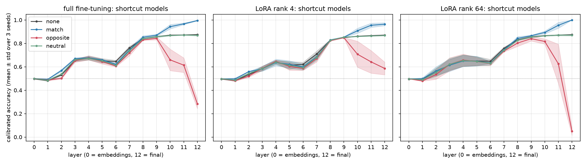
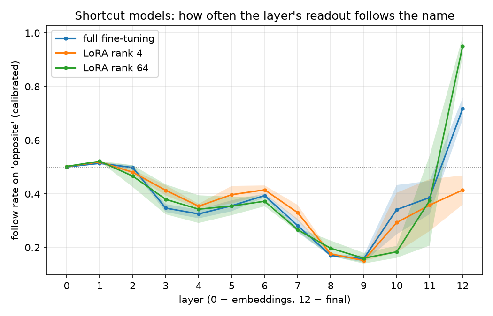
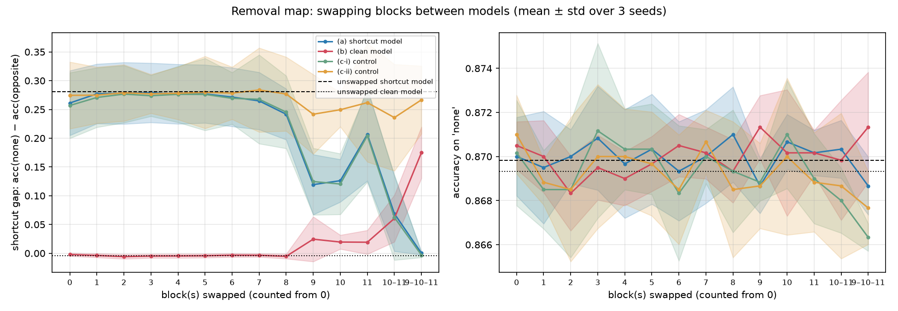
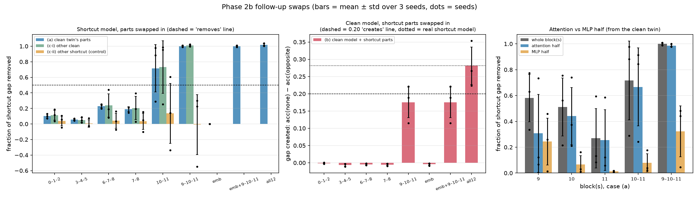
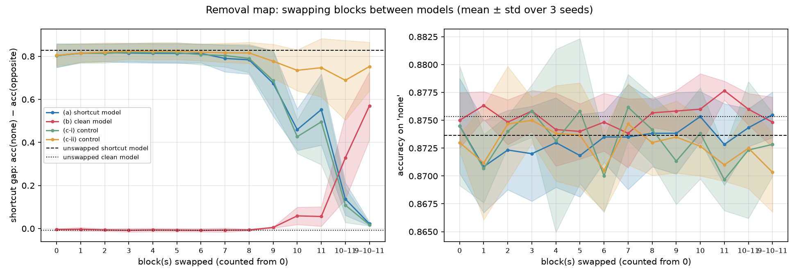
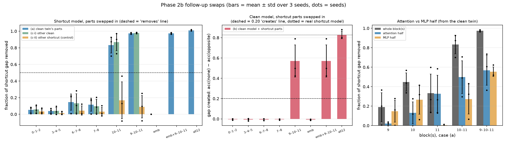

# RESULTS_LORA (LoRA on GPT-2)

_Generated by `src/report_lora.py` from results files only. Do not edit by hand._

## Notes

- The first attempt at the main runs (seeds 1-2) ran with transformers 5.20.1 instead of the pinned 5.19.0, after a pip network error during the Colab install. Its 8 runs were archived on Drive and not used; they were re-run with the pinned versions (the same numbers came out). Both attempts are in logs/run_lora.log; the notebooks now stop unless every pinned version is installed.
- LoRA learning rate: chosen by the Phase L1 pilot and its amendment (PROJECT_SPEC.md), decided after the pilot results by Sonu and stated as such; the lr was picked on seed 0, so seeds 1 and 2 are the independent check.
- Retraining (Phase 3) on LoRA models retrains the chosen blocks' full weights, as for GPT-2: a strong fix.
- Phase 2b 'emb_names' (swap only the name-token embedding rows) is a no-op by construction under LoRA: LoRA does not train the embeddings, so every LoRA model has the same name rows. Reported as not applicable, not as a finding.

## Phase L1: learning-rate pilot (seed 0)

Source: results/lora_pilot/ (16 runs). Checks as in the GPT-2 pilot (configs/pilot.yaml).

| run | lr | rank | kind | acc none | acc opposite | gap none−opp | checks | pass |
|---|---|---|---|---|---|---|---|---|
| lora_r4_lr1e-4_shortcut_seed0 | 0.0001 | 4 | shortcut | 0.857 | 0.857 | 0.000 | task_learned: PASS; shortcut_learned: FAIL | NO |
| lora_r4_lr1e-4_clean_seed0 | 0.0001 | 4 | clean | 0.856 | 0.859 | -0.002 | task_learned: PASS; clean_no_shortcut: PASS | yes |
| lora_r64_lr1e-4_shortcut_seed0 | 0.0001 | 64 | shortcut | 0.873 | 0.783 | 0.090 | task_learned: PASS; shortcut_learned: FAIL | NO |
| lora_r64_lr1e-4_clean_seed0 | 0.0001 | 64 | clean | 0.874 | 0.876 | -0.002 | task_learned: PASS; clean_no_shortcut: PASS | yes |
| lora_r4_lr3e-4_shortcut_seed0 | 0.0003 | 4 | shortcut | 0.869 | 0.834 | 0.035 | task_learned: PASS; shortcut_learned: FAIL | NO |
| lora_r4_lr3e-4_clean_seed0 | 0.0003 | 4 | clean | 0.865 | 0.869 | -0.004 | task_learned: PASS; clean_no_shortcut: PASS | yes |
| lora_r64_lr3e-4_shortcut_seed0 | 0.0003 | 64 | shortcut | 0.877 | 0.031 | 0.847 | task_learned: PASS; shortcut_learned: PASS | yes |
| lora_r64_lr3e-4_clean_seed0 | 0.0003 | 64 | clean | 0.877 | 0.886 | -0.009 | task_learned: PASS; clean_no_shortcut: PASS | yes |
| lora_r4_lr5e-4_shortcut_seed0 | 0.0005 | 4 | shortcut | 0.868 | 0.515 | 0.353 | task_learned: PASS; shortcut_learned: PASS | yes |
| lora_r4_lr5e-4_clean_seed0 | 0.0005 | 4 | clean | 0.871 | 0.872 | -0.001 | task_learned: PASS; clean_no_shortcut: PASS | yes |
| lora_r64_lr5e-4_shortcut_seed0 | 0.0005 | 64 | shortcut | 0.869 | 0.069 | 0.800 | task_learned: PASS; shortcut_learned: PASS | yes |
| lora_r64_lr5e-4_clean_seed0 | 0.0005 | 64 | clean | 0.874 | 0.877 | -0.003 | task_learned: PASS; clean_no_shortcut: PASS | yes |
| lora_r4_lr1e-3_shortcut_seed0 | 0.001 | 4 | shortcut | 0.870 | 0.287 | 0.583 | task_learned: PASS; shortcut_learned: PASS | yes |
| lora_r4_lr1e-3_clean_seed0 | 0.001 | 4 | clean | 0.875 | 0.882 | -0.007 | task_learned: PASS; clean_no_shortcut: PASS | yes |
| lora_r64_lr1e-3_shortcut_seed0 | 0.001 | 64 | shortcut | 0.758 | 0.383 | 0.375 | task_learned: FAIL; shortcut_learned: PASS | NO |
| lora_r64_lr1e-3_clean_seed0 | 0.001 | 64 | clean | 0.752 | 0.751 | 0.001 | task_learned: FAIL; clean_no_shortcut: PASS | NO |

- Pre-registered rule (results/lora_pilot/choice.json): chosen lr = None (no lr in the grid passes for both ranks: STOP and tell Sonu (Phase L1 rule)).
- Amendment, decided by Sonu after the pilot results (results/lora_pilot/choice_amended.json): B: 5e-4 passes for both ranks -> 5e-4 for both; lr per rank {'4': 0.0005, '64': 0.0005}.

## Main runs: checks (3 seeds per condition)

Full fine-tuning = the GPT-2 pilot (results/checks/); LoRA = results/lora_r{4,64}/checks/.

| condition | run | lr | acc none | acc match | acc opposite | gap none−opp | pass | train (min) | peak VRAM (GiB) | GPU | transformers |
|---|---|---|---|---|---|---|---|---|---|---|---|
| full fine-tuning | shortcut_seed0 | 5e-05 | 0.874 | 0.998 | 0.228 | 0.646 | yes | 9.7 | 3.56 | n/a | n/a |
| full fine-tuning | shortcut_seed1 | 5e-05 | 0.874 | 0.997 | 0.249 | 0.626 | yes | 9.4 | 3.57 | n/a | n/a |
| full fine-tuning | shortcut_seed2 | 5e-05 | 0.876 | 0.992 | 0.335 | 0.541 | yes | 9.4 | 3.57 | n/a | n/a |
| full fine-tuning | clean_seed0 | 5e-05 | 0.876 | 0.876 | 0.882 | -0.007 | yes | 9.5 | 3.58 | n/a | n/a |
| full fine-tuning | clean_seed1 | 5e-05 | 0.875 | 0.876 | 0.882 | -0.007 | yes | 9.4 | 3.57 | n/a | n/a |
| full fine-tuning | clean_seed2 | 5e-05 | 0.875 | 0.876 | 0.880 | -0.005 | yes | 9.4 | 3.57 | n/a | n/a |
| LoRA rank 4 | lora_r4_shortcut_seed0 | 0.0005 | 0.868 | 0.983 | 0.515 | 0.353 | yes | 4.4 | 2.50 | NVIDIA L4 | 5.19.0 |
| LoRA rank 4 | lora_r4_shortcut_seed1 | 0.0005 | 0.870 | 0.962 | 0.604 | 0.266 | yes | 4.6 | 2.50 | NVIDIA L4 | 5.19.0 |
| LoRA rank 4 | lora_r4_shortcut_seed2 | 0.0005 | 0.872 | 0.951 | 0.648 | 0.224 | yes | 4.6 | 2.50 | NVIDIA L4 | 5.19.0 |
| LoRA rank 4 | lora_r4_clean_seed0 | 0.0005 | 0.871 | 0.862 | 0.872 | -0.001 | yes | 4.5 | 2.50 | NVIDIA L4 | 5.19.0 |
| LoRA rank 4 | lora_r4_clean_seed1 | 0.0005 | 0.871 | 0.864 | 0.873 | -0.003 | yes | 4.6 | 2.50 | NVIDIA L4 | 5.19.0 |
| LoRA rank 4 | lora_r4_clean_seed2 | 0.0005 | 0.867 | 0.863 | 0.876 | -0.009 | yes | 4.6 | 2.50 | NVIDIA L4 | 5.19.0 |
| LoRA rank 64 | lora_r64_shortcut_seed0 | 0.0005 | 0.869 | 0.999 | 0.069 | 0.800 | yes | 4.7 | 2.62 | NVIDIA L4 | 5.19.0 |
| LoRA rank 64 | lora_r64_shortcut_seed1 | 0.0005 | 0.872 | 1.000 | 0.071 | 0.801 | yes | 4.7 | 2.62 | NVIDIA L4 | 5.19.0 |
| LoRA rank 64 | lora_r64_shortcut_seed2 | 0.0005 | 0.879 | 1.000 | 0.000 | 0.879 | yes | 4.7 | 2.62 | NVIDIA L4 | 5.19.0 |
| LoRA rank 64 | lora_r64_clean_seed0 | 0.0005 | 0.874 | 0.872 | 0.877 | -0.003 | yes | 4.7 | 2.62 | NVIDIA L4 | 5.19.0 |
| LoRA rank 64 | lora_r64_clean_seed1 | 0.0005 | 0.877 | 0.858 | 0.891 | -0.015 | yes | 4.7 | 2.62 | NVIDIA L4 | 5.19.0 |
| LoRA rank 64 | lora_r64_clean_seed2 | 0.0005 | 0.875 | 0.876 | 0.879 | -0.004 | yes | 4.7 | 2.62 | NVIDIA L4 | 5.19.0 |

Full fine-tuning lr: configs/pilot.yaml. GPU/versions of the full fine-tuning runs: not recorded per run (they ran before env logging was added; RTX 4050 laptop per SUMMARY.md).

## Logit lens (Phase L2): does the shortcut take over late?

Method and reading rule exactly as the GPT-2 logit lens (src/logit_lens.py unchanged; reading rule and thresholds imported from src/report.py): takeover layer = first layer from which the calibrated gap 'none' − 'opposite' (mean over seeds) stays ≥ 50% of its final value; 'overthinking' if the takeover is after layer 4 and the best layer for 'opposite' beats the final layer by ≥ 0.1; 'decided early' if the takeover is at or before layer 4. Layer L = output of block L−1 (0 = embeddings, 12 = final). Shortcut models, 3 seeds each.

| condition | final gap | takeover layer | best layer for 'opposite' | cal acc there vs final | gain | reading | same reading as full fine-tuning |
|---|---|---|---|---|---|---|---|
| full fine-tuning | 0.593 | 12 | 9 | 0.843 vs 0.283 | 0.560 | overthinking | — |
| LoRA rank 4 | 0.285 | 10 | 9 | 0.849 vs 0.586 | 0.263 | overthinking | yes |
| LoRA rank 64 | 0.825 | 12 | 9 | 0.840 vs 0.049 | 0.791 | overthinking | yes |

Per-seed early exit (shortcut models): best single layer for 'opposite' and the cost of stopping there on 'none'.

| condition | run | best layer | cal acc opposite there | final acc opposite | cal acc none there | final acc none | cost on none |
|---|---|---|---|---|---|---|---|
| full fine-tuning | shortcut_seed0 | 9 | 0.861 | 0.228 | 0.861 | 0.875 | 0.014 |
| full fine-tuning | shortcut_seed1 | 9 | 0.835 | 0.248 | 0.852 | 0.875 | 0.023 |
| full fine-tuning | shortcut_seed2 | 9 | 0.833 | 0.335 | 0.858 | 0.875 | 0.017 |
| LoRA rank 4 | lora_r4_shortcut_seed0 | 9 | 0.847 | 0.514 | 0.849 | 0.868 | 0.019 |
| LoRA rank 4 | lora_r4_shortcut_seed1 | 9 | 0.850 | 0.604 | 0.852 | 0.870 | 0.018 |
| LoRA rank 4 | lora_r4_shortcut_seed2 | 9 | 0.851 | 0.648 | 0.848 | 0.872 | 0.024 |
| LoRA rank 64 | lora_r64_shortcut_seed0 | 10 | 0.844 | 0.069 | 0.865 | 0.870 | 0.005 |
| LoRA rank 64 | lora_r64_shortcut_seed1 | 9 | 0.859 | 0.070 | 0.859 | 0.872 | 0.013 |
| LoRA rank 64 | lora_r64_shortcut_seed2 | 9 | 0.850 | 0.000 | 0.862 | 0.879 | 0.017 |

### Calibrated accuracy on 'opposite' per layer, shortcut models (mean ± std, per-seed values)

| layer | full fine-tuning | LoRA rank 4 | LoRA rank 64 |
|---|---|---|---|
| 0 | 0.500 ± 0.001 (0.501/0.499/0.499) | 0.498 ± 0.000 (0.498/0.498/0.498) | 0.498 ± 0.000 (0.498/0.498/0.498) |
| 1 | 0.486 ± 0.004 (0.481/0.487/0.490) | 0.481 ± 0.006 (0.474/0.487/0.482) | 0.478 ± 0.001 (0.477/0.479/0.479) |
| 2 | 0.502 ± 0.009 (0.494/0.498/0.514) | 0.520 ± 0.009 (0.512/0.515/0.532) | 0.534 ± 0.041 (0.490/0.588/0.524) |
| 3 | 0.653 ± 0.015 (0.640/0.645/0.674) | 0.587 ± 0.019 (0.614/0.574/0.574) | 0.621 ± 0.056 (0.544/0.642/0.675) |
| 4 | 0.675 ± 0.016 (0.655/0.674/0.696) | 0.646 ± 0.009 (0.635/0.657/0.647) | 0.657 ± 0.052 (0.588/0.673/0.711) |
| 5 | 0.645 ± 0.020 (0.619/0.646/0.669) | 0.603 ± 0.033 (0.596/0.568/0.646) | 0.645 ± 0.034 (0.600/0.655/0.681) |
| 6 | 0.606 ± 0.007 (0.598/0.607/0.615) | 0.585 ± 0.016 (0.609/0.575/0.573) | 0.628 ± 0.019 (0.610/0.653/0.620) |
| 7 | 0.719 ± 0.025 (0.734/0.683/0.739) | 0.670 ± 0.029 (0.709/0.662/0.640) | 0.734 ± 0.007 (0.730/0.744/0.729) |
| 8 | 0.830 ± 0.003 (0.835/0.826/0.830) | 0.824 ± 0.005 (0.826/0.818/0.829) | 0.803 ± 0.029 (0.762/0.826/0.822) |
| 9 | 0.843 ± 0.013 (0.861/0.835/0.833) | 0.849 ± 0.002 (0.847/0.850/0.851) | 0.840 ± 0.020 (0.812/0.859/0.850) |
| 10 | 0.659 ± 0.092 (0.758/0.681/0.537) | 0.707 ± 0.111 (0.748/0.819/0.555) | 0.817 ± 0.022 (0.844/0.789/0.816) |
| 11 | 0.614 ± 0.062 (0.670/0.644/0.527) | 0.642 ± 0.097 (0.521/0.758/0.646) | 0.625 ± 0.168 (0.708/0.392/0.777) |
| 12 | 0.283 ± 0.041 (0.242/0.268/0.339) | 0.586 ± 0.054 (0.513/0.601/0.644) | 0.049 ± 0.035 (0.076/0.071/0.000) |

### Calibrated accuracy on 'none' per layer, shortcut models (mean ± std, per-seed values)

| layer | full fine-tuning | LoRA rank 4 | LoRA rank 64 |
|---|---|---|---|
| 0 | 0.496 ± 0.001 (0.497/0.496/0.496) | 0.495 ± 0.000 (0.495/0.495/0.495) | 0.495 ± 0.000 (0.495/0.495/0.495) |
| 1 | 0.482 ± 0.006 (0.487/0.486/0.474) | 0.481 ± 0.004 (0.476/0.485/0.483) | 0.492 ± 0.006 (0.500/0.489/0.487) |
| 2 | 0.530 ± 0.004 (0.524/0.530/0.535) | 0.533 ± 0.000 (0.533/0.534/0.533) | 0.553 ± 0.033 (0.521/0.599/0.539) |
| 3 | 0.652 ± 0.008 (0.647/0.646/0.664) | 0.586 ± 0.019 (0.609/0.585/0.563) | 0.617 ± 0.046 (0.556/0.629/0.666) |
| 4 | 0.677 ± 0.019 (0.652/0.681/0.697) | 0.639 ± 0.018 (0.623/0.664/0.629) | 0.652 ± 0.049 (0.586/0.667/0.704) |
| 5 | 0.652 ± 0.019 (0.626/0.657/0.672) | 0.612 ± 0.033 (0.608/0.574/0.655) | 0.649 ± 0.039 (0.595/0.667/0.685) |
| 6 | 0.646 ± 0.010 (0.634/0.645/0.658) | 0.622 ± 0.017 (0.643/0.602/0.621) | 0.648 ± 0.016 (0.628/0.667/0.649) |
| 7 | 0.761 ± 0.015 (0.764/0.741/0.777) | 0.710 ± 0.025 (0.742/0.706/0.681) | 0.758 ± 0.011 (0.743/0.762/0.769) |
| 8 | 0.841 ± 0.004 (0.846/0.837/0.841) | 0.827 ± 0.005 (0.826/0.822/0.834) | 0.830 ± 0.005 (0.824/0.830/0.837) |
| 9 | 0.857 ± 0.004 (0.861/0.852/0.858) | 0.850 ± 0.002 (0.849/0.852/0.848) | 0.855 ± 0.007 (0.845/0.859/0.862) |
| 10 | 0.871 ± 0.002 (0.873/0.868/0.871) | 0.861 ± 0.002 (0.860/0.859/0.864) | 0.866 ± 0.003 (0.865/0.871/0.863) |
| 11 | 0.872 ± 0.001 (0.873/0.872/0.871) | 0.866 ± 0.003 (0.865/0.870/0.864) | 0.870 ± 0.002 (0.868/0.870/0.873) |
| 12 | 0.875 ± 0.003 (0.879/0.874/0.873) | 0.871 ± 0.002 (0.869/0.869/0.874) | 0.874 ± 0.003 (0.871/0.873/0.879) |

### Per-block drop on 'opposite', shortcut models (as in the GPT-2 report, a descriptive measure added there after its results)

Drop of block b = calibrated accuracy on 'opposite' at layer b minus at layer b+1.

| block b | full fine-tuning | LoRA rank 4 | LoRA rank 64 |
|---|---|---|---|
| 0 | 0.014 ± 0.004 (0.020/0.013/0.009) | 0.017 ± 0.006 (0.024/0.011/0.016) | 0.020 ± 0.001 (0.021/0.019/0.019) |
| 1 | -0.016 ± 0.005 (-0.013/-0.012/-0.024) | -0.039 ± 0.009 (-0.038/-0.028/-0.050) | -0.056 ± 0.040 (-0.013/-0.108/-0.045) |
| 2 | -0.151 ± 0.006 (-0.146/-0.147/-0.160) | -0.067 ± 0.025 (-0.102/-0.058/-0.041) | -0.087 ± 0.046 (-0.054/-0.054/-0.151) |
| 3 | -0.022 ± 0.006 (-0.015/-0.029/-0.021) | -0.059 ± 0.027 (-0.021/-0.084/-0.074) | -0.037 ± 0.005 (-0.043/-0.031/-0.035) |
| 4 | 0.030 ± 0.004 (0.036/0.028/0.026) | 0.043 ± 0.036 (0.039/0.090/0.001) | 0.012 ± 0.017 (-0.012/0.018/0.029) |
| 5 | 0.038 ± 0.013 (0.021/0.039/0.054) | 0.018 ± 0.040 (-0.013/-0.007/0.074) | 0.018 ± 0.031 (-0.010/0.002/0.061) |
| 6 | -0.112 ± 0.026 (-0.136/-0.077/-0.124) | -0.085 ± 0.014 (-0.100/-0.087/-0.068) | -0.106 ± 0.012 (-0.120/-0.091/-0.109) |
| 7 | -0.111 ± 0.022 (-0.101/-0.142/-0.091) | -0.154 ± 0.029 (-0.117/-0.155/-0.189) | -0.069 ± 0.026 (-0.033/-0.082/-0.093) |
| 8 | -0.013 ± 0.010 (-0.026/-0.009/-0.003) | -0.025 ± 0.005 (-0.021/-0.032/-0.022) | -0.037 ± 0.009 (-0.050/-0.033/-0.028) |
| 9 | 0.184 ± 0.082 (0.102/0.153/0.295) | 0.142 ± 0.112 (0.099/0.031/0.295) | 0.024 ± 0.042 (-0.031/0.070/0.034) |
| 10 | 0.045 ± 0.032 (0.088/0.037/0.010) | 0.065 ± 0.130 (0.227/0.060/-0.091) | 0.191 ± 0.152 (0.136/0.398/0.039) |
| 11 | 0.331 ± 0.103 (0.428/0.377/0.189) | 0.056 ± 0.072 (0.008/0.158/0.002) | 0.576 ± 0.191 (0.632/0.320/0.777) |

Logit-lens environment (results/lora_r{4,64}/logit_lens/env.json): lora_r4: NVIDIA L4, torch 2.11.0+cu130, transformers 5.19.0, peft 0.21.2, commit 97835ef; lora_r64: NVIDIA L4, torch 2.11.0+cu130, transformers 5.19.0, peft 0.21.2, commit 97835ef

## Swaps (Phase 2 and 2b, Phase L2)

Same cases, block sets, controls and reading rules as the GPT-2 Phase 2 and 2b (src/swap.py unchanged, run with --prefix). The tables and rule verdicts below are produced by src/report.py's own section and rule code, run unchanged on a copy of each rank's swap files with the run-name prefix removed (report.py looks runs up as shortcut_seed<s> / clean_seed<s>). G_s = gap of that rank's unswapped shortcut model of seed s.

### LoRA rank 4: Removal map: block swaps (Phase 2)

Source: results/lora_r4/swap/seed*.json (seeds 0, 1, 2). Forward passes only. Only the block weights (transformer.h.<b>.*) are swapped; embeddings, final layer norm and output matrix stay from the model being edited. "Another seed" = 0→1, 1→2, 2→0. Blocks are counted from 0; block b produces our logit-lens layer b+1.

Unswapped baselines (same evaluation code):

| model | none | match | opposite | neutral | gap |
|---|---|---|---|---|---|
| shortcut | 0.870 ± 0.001 (0.868/0.870/0.872) | 0.965 ± 0.013 (0.983/0.962/0.951) | 0.589 ± 0.056 (0.515/0.604/0.648) | 0.867 ± 0.003 (0.867/0.863/0.871) | 0.281 ± 0.054 (0.353/0.266/0.224) |
| clean | 0.869 ± 0.002 (0.871/0.871/0.867) | 0.863 ± 0.001 (0.862/0.864/0.863) | 0.874 ± 0.001 (0.872/0.873/0.876) | 0.870 ± 0.001 (0.868/0.872/0.870) | -0.004 ± 0.003 (-0.001/-0.003/-0.009) |

#### (a) shortcut model, block(s) from its clean twin (same seed)

Runs (edited ← donor): shortcut_seed0 ← clean_seed0, shortcut_seed1 ← clean_seed1, shortcut_seed2 ← clean_seed2. Cells: mean ± std (per-seed values).

| block(s) | gap none−opp | none | match | opposite | neutral |
|---|---|---|---|---|---|
| 0 | 0.261 ± 0.056 (0.338/0.243/0.203) | 0.870 ± 0.002 (0.868/0.872/0.871) | 0.964 ± 0.012 (0.979/0.961/0.950) | 0.609 ± 0.058 (0.530/0.629/0.668) | 0.867 ± 0.003 (0.865/0.865/0.871) |
| 1 | 0.277 ± 0.052 (0.346/0.265/0.221) | 0.870 ± 0.003 (0.866/0.871/0.872) | 0.965 ± 0.013 (0.981/0.962/0.951) | 0.592 ± 0.054 (0.520/0.606/0.651) | 0.867 ± 0.003 (0.865/0.864/0.871) |
| 2 | 0.278 ± 0.054 (0.350/0.263/0.222) | 0.870 ± 0.001 (0.868/0.870/0.872) | 0.965 ± 0.013 (0.982/0.961/0.951) | 0.592 ± 0.055 (0.518/0.607/0.650) | 0.867 ± 0.003 (0.865/0.864/0.872) |
| 3 | 0.279 ± 0.052 (0.347/0.268/0.222) | 0.871 ± 0.002 (0.868/0.873/0.873) | 0.965 ± 0.014 (0.983/0.962/0.950) | 0.592 ± 0.054 (0.521/0.604/0.650) | 0.867 ± 0.004 (0.865/0.863/0.872) |
| 4 | 0.277 ± 0.052 (0.346/0.262/0.221) | 0.870 ± 0.002 (0.867/0.870/0.873) | 0.964 ± 0.013 (0.982/0.960/0.951) | 0.593 ± 0.054 (0.521/0.608/0.651) | 0.868 ± 0.003 (0.867/0.864/0.873) |
| 5 | 0.277 ± 0.051 (0.344/0.265/0.222) | 0.870 ± 0.002 (0.867/0.871/0.873) | 0.965 ± 0.014 (0.983/0.961/0.950) | 0.593 ± 0.053 (0.523/0.606/0.651) | 0.867 ± 0.004 (0.867/0.863/0.872) |
| 6 | 0.271 ± 0.051 (0.340/0.255/0.218) | 0.869 ± 0.002 (0.867/0.869/0.872) | 0.964 ± 0.013 (0.980/0.961/0.950) | 0.598 ± 0.053 (0.526/0.614/0.654) | 0.868 ± 0.004 (0.867/0.865/0.873) |
| 7 | 0.265 ± 0.050 (0.328/0.260/0.206) | 0.870 ± 0.002 (0.867/0.872/0.872) | 0.963 ± 0.012 (0.978/0.961/0.950) | 0.605 ± 0.052 (0.539/0.612/0.665) | 0.868 ± 0.004 (0.868/0.864/0.873) |
| 8 | 0.242 ± 0.044 (0.299/0.236/0.191) | 0.871 ± 0.002 (0.869/0.870/0.874) | 0.959 ± 0.013 (0.975/0.958/0.945) | 0.629 ± 0.046 (0.571/0.634/0.683) | 0.869 ± 0.004 (0.868/0.865/0.874) |
| 9 | 0.119 ± 0.052 (0.131/0.177/0.050) | 0.869 ± 0.001 (0.869/0.870/0.867) | 0.932 ± 0.013 (0.941/0.942/0.914) | 0.749 ± 0.051 (0.738/0.693/0.817) | 0.869 ± 0.002 (0.871/0.867/0.870) |
| 10 | 0.126 ± 0.037 (0.086/0.116/0.175) | 0.871 ± 0.001 (0.869/0.872/0.871) | 0.931 ± 0.005 (0.925/0.933/0.936) | 0.745 ± 0.036 (0.783/0.756/0.696) | 0.871 ± 0.001 (0.871/0.870/0.872) |
| 11 | 0.207 ± 0.081 (0.307/0.109/0.205) | 0.870 ± 0.001 (0.869/0.870/0.872) | 0.954 ± 0.016 (0.975/0.937/0.948) | 0.663 ± 0.081 (0.562/0.762/0.666) | 0.868 ± 0.003 (0.867/0.864/0.872) |
| 10-11 | 0.069 ± 0.065 (0.041/0.006/0.159) | 0.870 ± 0.001 (0.868/0.871/0.872) | 0.902 ± 0.022 (0.902/0.876/0.929) | 0.802 ± 0.065 (0.827/0.865/0.712) | 0.870 ± 0.001 (0.868/0.871/0.871) |
| 9-10-11 | 0.000 ± 0.003 (0.004/-0.003/-0.001) | 0.869 ± 0.001 (0.871/0.868/0.868) | 0.870 ± 0.001 (0.869/0.869/0.872) | 0.869 ± 0.002 (0.867/0.871/0.868) | 0.870 ± 0.002 (0.868/0.872/0.872) |

#### (b) clean model, block(s) from the shortcut model (same seed)

Runs (edited ← donor): clean_seed0 ← shortcut_seed0, clean_seed1 ← shortcut_seed1, clean_seed2 ← shortcut_seed2. Cells: mean ± std (per-seed values).

| block(s) | gap none−opp | none | match | opposite | neutral |
|---|---|---|---|---|---|
| 0 | -0.002 ± 0.003 (0.000/-0.001/-0.006) | 0.871 ± 0.001 (0.871/0.872/0.869) | 0.865 ± 0.002 (0.863/0.865/0.867) | 0.873 ± 0.002 (0.871/0.873/0.875) | 0.870 ± 0.001 (0.868/0.871/0.871) |
| 1 | -0.004 ± 0.003 (0.000/-0.004/-0.008) | 0.870 ± 0.002 (0.872/0.870/0.868) | 0.862 ± 0.000 (0.862/0.863/0.863) | 0.874 ± 0.002 (0.872/0.874/0.876) | 0.870 ± 0.001 (0.868/0.870/0.872) |
| 2 | -0.006 ± 0.004 (-0.002/-0.005/-0.011) | 0.868 ± 0.002 (0.870/0.869/0.866) | 0.863 ± 0.001 (0.863/0.864/0.862) | 0.874 ± 0.002 (0.872/0.874/0.877) | 0.869 ± 0.001 (0.868/0.869/0.870) |
| 3 | -0.005 ± 0.003 (-0.002/-0.003/-0.009) | 0.870 ± 0.001 (0.871/0.870/0.868) | 0.863 ± 0.001 (0.862/0.863/0.863) | 0.874 ± 0.002 (0.873/0.873/0.877) | 0.870 ± 0.001 (0.868/0.871/0.871) |
| 4 | -0.005 ± 0.004 (-0.001/-0.003/-0.009) | 0.869 ± 0.001 (0.871/0.869/0.868) | 0.863 ± 0.000 (0.863/0.863/0.863) | 0.874 ± 0.002 (0.872/0.873/0.877) | 0.870 ± 0.002 (0.868/0.871/0.873) |
| 5 | -0.004 ± 0.003 (-0.002/-0.002/-0.009) | 0.870 ± 0.001 (0.870/0.871/0.868) | 0.863 ± 0.001 (0.862/0.863/0.863) | 0.874 ± 0.002 (0.872/0.873/0.877) | 0.870 ± 0.000 (0.869/0.871/0.871) |
| 6 | -0.003 ± 0.003 (-0.001/-0.001/-0.008) | 0.871 ± 0.001 (0.872/0.872/0.868) | 0.863 ± 0.001 (0.862/0.864/0.863) | 0.874 ± 0.002 (0.873/0.873/0.877) | 0.870 ± 0.001 (0.869/0.869/0.872) |
| 7 | -0.004 ± 0.003 (-0.001/-0.002/-0.007) | 0.870 ± 0.001 (0.871/0.871/0.868) | 0.863 ± 0.001 (0.862/0.864/0.863) | 0.874 ± 0.002 (0.872/0.873/0.876) | 0.870 ± 0.000 (0.870/0.871/0.870) |
| 8 | -0.005 ± 0.004 (-0.001/-0.005/-0.011) | 0.869 ± 0.001 (0.871/0.869/0.868) | 0.864 ± 0.001 (0.863/0.866/0.863) | 0.875 ± 0.003 (0.872/0.874/0.878) | 0.870 ± 0.002 (0.871/0.872/0.868) |
| 9 | 0.025 ± 0.039 (0.000/-0.006/0.080) | 0.871 ± 0.001 (0.869/0.873/0.872) | 0.882 ± 0.019 (0.871/0.867/0.910) | 0.847 ± 0.039 (0.869/0.879/0.792) | 0.871 ± 0.001 (0.870/0.873/0.872) |
| 10 | 0.020 ± 0.012 (0.037/0.012/0.010) | 0.870 ± 0.003 (0.871/0.873/0.867) | 0.887 ± 0.009 (0.899/0.877/0.886) | 0.851 ± 0.012 (0.834/0.861/0.857) | 0.870 ± 0.001 (0.869/0.870/0.871) |
| 11 | 0.019 ± 0.021 (0.010/0.048/0.000) | 0.870 ± 0.001 (0.870/0.872/0.869) | 0.882 ± 0.012 (0.874/0.899/0.873) | 0.851 ± 0.020 (0.860/0.823/0.869) | 0.870 ± 0.001 (0.869/0.871/0.871) |
| 10-11 | 0.061 ± 0.041 (0.049/0.115/0.017) | 0.870 ± 0.003 (0.869/0.873/0.867) | 0.908 ± 0.014 (0.905/0.927/0.891) | 0.809 ± 0.038 (0.820/0.758/0.850) | 0.870 ± 0.001 (0.870/0.868/0.871) |
| 9-10-11 | 0.175 ± 0.045 (0.221/0.188/0.115) | 0.871 ± 0.002 (0.868/0.874/0.872) | 0.947 ± 0.014 (0.964/0.946/0.930) | 0.696 ± 0.046 (0.646/0.686/0.757) | 0.869 ± 0.003 (0.866/0.869/0.873) |

#### (c-i) control: shortcut model, block(s) from a clean model of another seed

Runs (edited ← donor): shortcut_seed0 ← clean_seed1, shortcut_seed1 ← clean_seed2, shortcut_seed2 ← clean_seed0. Cells: mean ± std (per-seed values).

| block(s) | gap none−opp | none | match | opposite | neutral |
|---|---|---|---|---|---|
| 0 | 0.257 ± 0.057 (0.334/0.237/0.199) | 0.870 ± 0.002 (0.868/0.873/0.869) | 0.962 ± 0.013 (0.979/0.961/0.947) | 0.613 ± 0.058 (0.534/0.637/0.670) | 0.870 ± 0.002 (0.868/0.871/0.872) |
| 1 | 0.271 ± 0.052 (0.340/0.258/0.215) | 0.868 ± 0.002 (0.868/0.871/0.867) | 0.964 ± 0.013 (0.980/0.960/0.951) | 0.598 ± 0.052 (0.528/0.613/0.652) | 0.869 ± 0.006 (0.865/0.864/0.877) |
| 2 | 0.277 ± 0.050 (0.347/0.249/0.234) | 0.868 ± 0.003 (0.865/0.868/0.873) | 0.965 ± 0.013 (0.982/0.961/0.952) | 0.592 ± 0.052 (0.518/0.618/0.638) | 0.867 ± 0.004 (0.864/0.864/0.872) |
| 3 | 0.274 ± 0.036 (0.320/0.269/0.233) | 0.871 ± 0.004 (0.867/0.870/0.877) | 0.964 ± 0.011 (0.979/0.961/0.951) | 0.597 ± 0.040 (0.547/0.601/0.643) | 0.867 ± 0.004 (0.864/0.864/0.873) |
| 4 | 0.276 ± 0.049 (0.343/0.259/0.228) | 0.870 ± 0.002 (0.868/0.871/0.873) | 0.964 ± 0.013 (0.981/0.961/0.950) | 0.594 ± 0.051 (0.525/0.612/0.645) | 0.869 ± 0.004 (0.868/0.865/0.874) |
| 5 | 0.276 ± 0.063 (0.357/0.266/0.205) | 0.870 ± 0.002 (0.868/0.873/0.870) | 0.964 ± 0.014 (0.983/0.961/0.950) | 0.594 ± 0.064 (0.511/0.607/0.665) | 0.870 ± 0.002 (0.870/0.867/0.873) |
| 6 | 0.269 ± 0.045 (0.326/0.266/0.216) | 0.868 ± 0.003 (0.864/0.871/0.871) | 0.962 ± 0.013 (0.979/0.961/0.947) | 0.599 ± 0.048 (0.538/0.604/0.655) | 0.869 ± 0.002 (0.868/0.867/0.872) |
| 7 | 0.268 ± 0.077 (0.368/0.256/0.179) | 0.870 ± 0.001 (0.868/0.872/0.870) | 0.963 ± 0.015 (0.983/0.961/0.946) | 0.602 ± 0.078 (0.501/0.615/0.691) | 0.868 ± 0.003 (0.865/0.866/0.872) |
| 8 | 0.245 ± 0.063 (0.329/0.230/0.177) | 0.869 ± 0.003 (0.865/0.872/0.871) | 0.959 ± 0.015 (0.979/0.956/0.943) | 0.624 ± 0.065 (0.536/0.641/0.694) | 0.869 ± 0.004 (0.866/0.867/0.875) |
| 9 | 0.125 ± 0.058 (0.138/0.188/0.048) | 0.869 ± 0.001 (0.868/0.870/0.868) | 0.933 ± 0.016 (0.941/0.947/0.911) | 0.744 ± 0.057 (0.730/0.682/0.820) | 0.868 ± 0.003 (0.868/0.865/0.872) |
| 10 | 0.120 ± 0.053 (0.059/0.114/0.188) | 0.871 ± 0.002 (0.868/0.874/0.871) | 0.925 ± 0.012 (0.908/0.930/0.937) | 0.751 ± 0.052 (0.809/0.760/0.683) | 0.872 ± 0.002 (0.869/0.874/0.872) |
| 11 | 0.204 ± 0.080 (0.305/0.109/0.199) | 0.869 ± 0.002 (0.869/0.867/0.872) | 0.953 ± 0.018 (0.976/0.934/0.947) | 0.665 ± 0.079 (0.564/0.758/0.673) | 0.868 ± 0.003 (0.868/0.864/0.872) |
| 10-11 | 0.062 ± 0.074 (0.016/0.003/0.167) | 0.868 ± 0.001 (0.867/0.868/0.870) | 0.895 ± 0.024 (0.887/0.871/0.927) | 0.806 ± 0.073 (0.850/0.864/0.703) | 0.871 ± 0.002 (0.869/0.871/0.873) |
| 9-10-11 | -0.003 ± 0.004 (-0.009/0.002/-0.002) | 0.866 ± 0.001 (0.865/0.867/0.867) | 0.870 ± 0.002 (0.872/0.867/0.872) | 0.870 ± 0.003 (0.874/0.865/0.869) | 0.870 ± 0.000 (0.870/0.869/0.871) |

#### (c-ii) control: shortcut model, block(s) from a shortcut model of another seed

Runs (edited ← donor): shortcut_seed0 ← shortcut_seed1, shortcut_seed1 ← shortcut_seed2, shortcut_seed2 ← shortcut_seed0. Cells: mean ± std (per-seed values).

| block(s) | gap none−opp | none | match | opposite | neutral |
|---|---|---|---|---|---|
| 0 | 0.274 ± 0.058 (0.353/0.256/0.215) | 0.871 ± 0.002 (0.869/0.873/0.870) | 0.965 ± 0.014 (0.983/0.964/0.947) | 0.596 ± 0.059 (0.516/0.618/0.655) | 0.870 ± 0.003 (0.867/0.871/0.873) |
| 1 | 0.275 ± 0.049 (0.340/0.262/0.223) | 0.869 ± 0.001 (0.868/0.870/0.869) | 0.964 ± 0.012 (0.981/0.960/0.952) | 0.594 ± 0.050 (0.527/0.608/0.646) | 0.868 ± 0.005 (0.865/0.864/0.875) |
| 2 | 0.279 ± 0.049 (0.347/0.253/0.235) | 0.868 ± 0.003 (0.864/0.868/0.873) | 0.965 ± 0.012 (0.982/0.962/0.952) | 0.590 ± 0.052 (0.517/0.615/0.637) | 0.866 ± 0.004 (0.864/0.863/0.872) |
| 3 | 0.277 ± 0.034 (0.321/0.273/0.238) | 0.870 ± 0.003 (0.866/0.870/0.874) | 0.964 ± 0.010 (0.978/0.962/0.952) | 0.593 ± 0.037 (0.545/0.597/0.636) | 0.868 ± 0.004 (0.864/0.866/0.873) |
| 4 | 0.278 ± 0.046 (0.340/0.265/0.230) | 0.870 ± 0.002 (0.867/0.871/0.872) | 0.965 ± 0.013 (0.982/0.962/0.951) | 0.592 ± 0.048 (0.527/0.606/0.642) | 0.869 ± 0.004 (0.868/0.865/0.874) |
| 5 | 0.280 ± 0.063 (0.360/0.272/0.207) | 0.870 ± 0.002 (0.868/0.873/0.868) | 0.965 ± 0.014 (0.983/0.961/0.950) | 0.590 ± 0.063 (0.508/0.601/0.661) | 0.870 ± 0.002 (0.871/0.867/0.872) |
| 6 | 0.278 ± 0.045 (0.336/0.273/0.226) | 0.869 ± 0.002 (0.865/0.870/0.871) | 0.963 ± 0.013 (0.980/0.961/0.948) | 0.590 ± 0.048 (0.529/0.597/0.645) | 0.868 ± 0.001 (0.868/0.867/0.870) |
| 7 | 0.284 ± 0.073 (0.378/0.275/0.199) | 0.871 ± 0.001 (0.869/0.873/0.871) | 0.965 ± 0.015 (0.984/0.964/0.947) | 0.587 ± 0.074 (0.491/0.598/0.672) | 0.867 ± 0.003 (0.865/0.865/0.871) |
| 8 | 0.277 ± 0.064 (0.364/0.254/0.212) | 0.868 ± 0.003 (0.865/0.873/0.868) | 0.964 ± 0.014 (0.984/0.960/0.950) | 0.592 ± 0.066 (0.501/0.618/0.656) | 0.868 ± 0.003 (0.867/0.865/0.873) |
| 9 | 0.242 ± 0.069 (0.262/0.314/0.149) | 0.869 ± 0.002 (0.869/0.871/0.866) | 0.960 ± 0.006 (0.968/0.959/0.952) | 0.627 ± 0.067 (0.607/0.557/0.717) | 0.869 ± 0.002 (0.868/0.867/0.873) |
| 10 | 0.249 ± 0.030 (0.246/0.215/0.287) | 0.870 ± 0.004 (0.865/0.873/0.872) | 0.960 ± 0.002 (0.963/0.958/0.960) | 0.621 ± 0.030 (0.619/0.658/0.585) | 0.870 ± 0.002 (0.868/0.871/0.872) |
| 11 | 0.262 ± 0.103 (0.400/0.154/0.231) | 0.869 ± 0.002 (0.867/0.868/0.872) | 0.962 ± 0.017 (0.986/0.947/0.951) | 0.607 ± 0.104 (0.467/0.714/0.641) | 0.869 ± 0.003 (0.868/0.865/0.873) |
| 10-11 | 0.236 ± 0.093 (0.303/0.105/0.299) | 0.869 ± 0.003 (0.865/0.868/0.873) | 0.957 ± 0.012 (0.970/0.941/0.960) | 0.633 ± 0.092 (0.562/0.763/0.574) | 0.870 ± 0.001 (0.868/0.872/0.869) |
| 9-10-11 | 0.267 ± 0.059 (0.248/0.206/0.346) | 0.868 ± 0.002 (0.865/0.869/0.868) | 0.963 ± 0.012 (0.964/0.947/0.978) | 0.601 ± 0.059 (0.618/0.664/0.521) | 0.868 ± 0.000 (0.868/0.868/0.868) |

### LoRA rank 4: Phase 2 reading rule

_Same rule as GPT-2 Phase 2; applied to LoRA as pre-registered in PROJECT_SPEC.md Phase L2 (20 Oct)._

Per seed s, against that seed's unswapped shortcut model (gap G_s). **removes**: gap ≤ 50% of G_s and acc(none) drops by ≤ 0.02. **not just breaking**: the c-ii swap keeps gap ≥ 80% of G_s. **creates**: case (b) gap ≥ 0.2. Verdict PASS only if all seeds pass (per-seed P/F in seed order 0, 1, 2).

| block(s) | (a) removes | (c-i) removes | (c-ii) not just breaking | (b) creates | (a) fraction of gap removed (per seed) |
|---|---|---|---|---|---|
| 0 | **FAIL** (F/F/F) | **FAIL** (F/F/F) | **PASS** (P/P/P) | **FAIL** (F/F/F) | 0.045/0.090/0.089 |
| 1 | **FAIL** (F/F/F) | **FAIL** (F/F/F) | **PASS** (P/P/P) | **FAIL** (F/F/F) | 0.021/0.008/0.011 |
| 2 | **FAIL** (F/F/F) | **FAIL** (F/F/F) | **PASS** (P/P/P) | **FAIL** (F/F/F) | 0.010/0.013/0.009 |
| 3 | **FAIL** (F/F/F) | **FAIL** (F/F/F) | **PASS** (P/P/P) | **FAIL** (F/F/F) | 0.018/-0.006/0.007 |
| 4 | **FAIL** (F/F/F) | **FAIL** (F/F/F) | **PASS** (P/P/P) | **FAIL** (F/F/F) | 0.021/0.015/0.009 |
| 5 | **FAIL** (F/F/F) | **FAIL** (F/F/F) | **PASS** (P/P/P) | **FAIL** (F/F/F) | 0.027/0.006/0.007 |
| 6 | **FAIL** (F/F/F) | **FAIL** (F/F/F) | **PASS** (P/P/P) | **FAIL** (F/F/F) | 0.037/0.041/0.022 |
| 7 | **FAIL** (F/F/F) | **FAIL** (F/F/F) | **PASS** (P/P/P) | **FAIL** (F/F/F) | 0.072/0.024/0.076 |
| 8 | **FAIL** (F/F/F) | **FAIL** (F/F/F) | **PASS** (P/P/P) | **FAIL** (F/F/F) | 0.156/0.114/0.148 |
| 9 | **FAIL** (P/F/P) | **FAIL** (P/F/P) | **FAIL** (F/P/F) | **FAIL** (F/F/F) | 0.631/0.336/0.774 |
| 10 | **FAIL** (P/P/F) | **FAIL** (P/P/F) | **FAIL** (F/P/P) | **FAIL** (F/F/F) | 0.755/0.563/0.215 |
| 11 | **FAIL** (F/P/F) | **FAIL** (F/P/F) | **FAIL** (P/F/P) | **FAIL** (F/F/F) | 0.133/0.593/0.083 |
| 10-11 | **FAIL** (P/P/F) | **FAIL** (P/P/F) | **FAIL** (P/F/P) | **FAIL** (F/F/F) | 0.883/0.977/0.289 |
| 9-10-11 | **PASS** (P/P/P) | **PASS** (P/P/P) | **FAIL** (F/F/P) | **FAIL** (P/F/F) | 0.989/1.009/1.004 |

### LoRA rank 4: Phase 2b: follow-up swaps

Source: results/lora_r4/swap2/seed*.json (seeds 0, 1, 2); whole-block 9, 10, 11, 10-11, 9-10-11 numbers come from results/lora_r4/swap (Phase 2). Rules pre-registered in PROJECT_SPEC.md on 15 Oct before any Phase 2b run. Per-seed values are in seed order. G_s = gap of the unswapped shortcut model.

Name-token rows swapped for emb_names: ids [309, 808, 2744, 3304, 3461, 5404, 10438, 11023, 11252, 12528, 20637, 33268] (A, B and N from data/manifest.json); label rows {'positive': 3967, 'negative': 4633} asserted unchanged.

#### (a) shortcut model, block(s) from its clean twin (same seed)

| set | gap none−opp | none | match | opposite | neutral |
|---|---|---|---|---|---|
| 0-1-2 | 0.254 ± 0.056 (0.328/0.239/0.194) | 0.869 ± 0.002 (0.866/0.870/0.872) | 0.962 ± 0.013 (0.978/0.961/0.946) | 0.615 ± 0.058 (0.538/0.631/0.678) | 0.868 ± 0.003 (0.864/0.868/0.872) |
| 3-4-5 | 0.266 ± 0.052 (0.333/0.256/0.208) | 0.871 ± 0.003 (0.867/0.873/0.873) | 0.962 ± 0.013 (0.979/0.960/0.947) | 0.606 ± 0.055 (0.534/0.618/0.665) | 0.867 ± 0.003 (0.864/0.864/0.872) |
| 6-7-8 | 0.216 ± 0.039 (0.264/0.214/0.169) | 0.871 ± 0.002 (0.868/0.871/0.873) | 0.955 ± 0.014 (0.971/0.956/0.938) | 0.655 ± 0.041 (0.604/0.657/0.704) | 0.869 ± 0.003 (0.868/0.866/0.874) |
| 7-8 | 0.228 ± 0.042 (0.279/0.228/0.176) | 0.871 ± 0.002 (0.868/0.871/0.874) | 0.956 ± 0.014 (0.974/0.956/0.939) | 0.644 ± 0.044 (0.590/0.643/0.698) | 0.870 ± 0.004 (0.868/0.867/0.874) |
| emb_names | 0.281 ± 0.054 (0.353/0.266/0.224) | 0.870 ± 0.001 (0.868/0.870/0.872) | 0.965 ± 0.013 (0.983/0.962/0.951) | 0.589 ± 0.056 (0.515/0.604/0.648) | 0.867 ± 0.003 (0.867/0.863/0.871) |
| emb_names+9-10-11 | 0.000 ± 0.003 (0.004/-0.003/-0.001) | 0.869 ± 0.001 (0.871/0.868/0.868) | 0.870 ± 0.001 (0.869/0.869/0.872) | 0.869 ± 0.002 (0.867/0.871/0.868) | 0.870 ± 0.002 (0.868/0.872/0.872) |
| all12 | -0.004 ± 0.003 (-0.001/-0.003/-0.009) | 0.869 ± 0.002 (0.871/0.871/0.867) | 0.863 ± 0.001 (0.862/0.864/0.863) | 0.874 ± 0.001 (0.872/0.873/0.876) | 0.870 ± 0.001 (0.868/0.872/0.870) |
| attn:9 | 0.206 ± 0.107 (0.310/0.249/0.059) | 0.868 ± 0.002 (0.869/0.870/0.865) | 0.952 ± 0.025 (0.977/0.961/0.918) | 0.662 ± 0.105 (0.559/0.621/0.806) | 0.867 ± 0.002 (0.868/0.864/0.868) |
| mlp:9 | 0.203 ± 0.012 (0.191/0.197/0.220) | 0.870 ± 0.002 (0.868/0.869/0.872) | 0.948 ± 0.001 (0.950/0.947/0.949) | 0.667 ± 0.011 (0.677/0.672/0.651) | 0.869 ± 0.003 (0.871/0.865/0.872) |
| attn:10 | 0.145 ± 0.038 (0.092/0.167/0.177) | 0.871 ± 0.001 (0.869/0.872/0.871) | 0.935 ± 0.006 (0.927/0.942/0.937) | 0.725 ± 0.037 (0.777/0.705/0.694) | 0.871 ± 0.001 (0.870/0.871/0.873) |
| mlp:10 | 0.263 ± 0.057 (0.343/0.224/0.221) | 0.870 ± 0.001 (0.868/0.870/0.872) | 0.963 ± 0.013 (0.982/0.956/0.951) | 0.607 ± 0.058 (0.525/0.646/0.650) | 0.867 ± 0.003 (0.867/0.864/0.871) |
| attn:11 | 0.210 ± 0.082 (0.310/0.110/0.211) | 0.870 ± 0.001 (0.868/0.870/0.871) | 0.954 ± 0.016 (0.976/0.938/0.949) | 0.659 ± 0.082 (0.558/0.760/0.660) | 0.868 ± 0.003 (0.868/0.864/0.872) |
| mlp:11 | 0.277 ± 0.053 (0.347/0.265/0.220) | 0.870 ± 0.001 (0.868/0.870/0.872) | 0.965 ± 0.013 (0.982/0.961/0.951) | 0.593 ± 0.054 (0.521/0.605/0.651) | 0.867 ± 0.003 (0.866/0.864/0.872) |
| attn:10-11 | 0.083 ± 0.063 (0.055/0.023/0.169) | 0.871 ± 0.001 (0.869/0.872/0.872) | 0.907 ± 0.018 (0.906/0.886/0.930) | 0.788 ± 0.062 (0.814/0.849/0.702) | 0.870 ± 0.001 (0.868/0.870/0.872) |
| mlp:10-11 | 0.259 ± 0.057 (0.340/0.220/0.218) | 0.870 ± 0.001 (0.868/0.870/0.872) | 0.961 ± 0.013 (0.979/0.956/0.950) | 0.611 ± 0.058 (0.529/0.650/0.654) | 0.868 ± 0.003 (0.867/0.865/0.872) |
| attn:9-10-11 | 0.004 ± 0.003 (0.008/0.005/0.000) | 0.868 ± 0.002 (0.869/0.869/0.865) | 0.875 ± 0.002 (0.877/0.873/0.874) | 0.864 ± 0.002 (0.862/0.864/0.865) | 0.871 ± 0.001 (0.869/0.871/0.872) |
| mlp:9-10-11 | 0.182 ± 0.026 (0.183/0.149/0.213) | 0.870 ± 0.002 (0.868/0.869/0.872) | 0.945 ± 0.005 (0.948/0.938/0.948) | 0.688 ± 0.025 (0.684/0.720/0.659) | 0.870 ± 0.002 (0.869/0.867/0.873) |

#### (b) clean model, block(s) from the shortcut model (same seed)

| set | gap none−opp | none | match | opposite | neutral |
|---|---|---|---|---|---|
| 0-1-2 | -0.002 ± 0.002 (0.001/-0.002/-0.003) | 0.870 ± 0.000 (0.870/0.870/0.869) | 0.866 ± 0.002 (0.863/0.867/0.868) | 0.871 ± 0.001 (0.869/0.873/0.873) | 0.869 ± 0.001 (0.867/0.870/0.870) |
| 3-4-5 | -0.006 ± 0.004 (-0.003/-0.004/-0.012) | 0.868 ± 0.001 (0.869/0.868/0.867) | 0.864 ± 0.000 (0.864/0.863/0.864) | 0.874 ± 0.003 (0.873/0.873/0.878) | 0.870 ± 0.001 (0.869/0.870/0.871) |
| 6-7-8 | -0.005 ± 0.002 (-0.002/-0.005/-0.008) | 0.869 ± 0.002 (0.872/0.868/0.868) | 0.864 ± 0.001 (0.863/0.864/0.864) | 0.874 ± 0.001 (0.873/0.873/0.876) | 0.869 ± 0.001 (0.868/0.871/0.868) |
| 7-8 | -0.005 ± 0.003 (-0.002/-0.004/-0.010) | 0.869 ± 0.002 (0.870/0.871/0.867) | 0.864 ± 0.001 (0.863/0.866/0.864) | 0.875 ± 0.002 (0.873/0.875/0.877) | 0.870 ± 0.001 (0.870/0.871/0.868) |
| emb_names | -0.004 ± 0.003 (-0.001/-0.003/-0.009) | 0.869 ± 0.002 (0.871/0.871/0.867) | 0.863 ± 0.001 (0.862/0.864/0.863) | 0.874 ± 0.001 (0.872/0.873/0.876) | 0.870 ± 0.001 (0.868/0.872/0.870) |
| emb_names+9-10-11 | 0.175 ± 0.045 (0.221/0.188/0.115) | 0.871 ± 0.002 (0.868/0.874/0.872) | 0.947 ± 0.014 (0.964/0.946/0.930) | 0.696 ± 0.046 (0.646/0.686/0.757) | 0.869 ± 0.003 (0.866/0.869/0.873) |
| all12 | 0.281 ± 0.054 (0.353/0.266/0.224) | 0.870 ± 0.001 (0.868/0.870/0.872) | 0.965 ± 0.013 (0.983/0.962/0.951) | 0.589 ± 0.056 (0.515/0.604/0.648) | 0.867 ± 0.003 (0.867/0.863/0.871) |

#### (c-i) control: shortcut model, block(s) from a clean model of another seed

| set | gap none−opp | none | match | opposite | neutral |
|---|---|---|---|---|---|
| 0-1-2 | 0.248 ± 0.046 (0.313/0.217/0.215) | 0.870 ± 0.003 (0.867/0.869/0.874) | 0.961 ± 0.012 (0.978/0.956/0.950) | 0.621 ± 0.048 (0.553/0.652/0.659) | 0.869 ± 0.003 (0.865/0.868/0.873) |
| 3-4-5 | 0.266 ± 0.044 (0.322/0.262/0.214) | 0.871 ± 0.002 (0.869/0.871/0.874) | 0.962 ± 0.011 (0.977/0.959/0.950) | 0.606 ± 0.046 (0.548/0.609/0.660) | 0.870 ± 0.004 (0.869/0.865/0.874) |
| 6-7-8 | 0.222 ± 0.082 (0.325/0.215/0.125) | 0.870 ± 0.002 (0.867/0.870/0.872) | 0.954 ± 0.019 (0.980/0.949/0.934) | 0.648 ± 0.084 (0.542/0.655/0.747) | 0.868 ± 0.004 (0.863/0.871/0.871) |
| 7-8 | 0.231 ± 0.086 (0.344/0.215/0.135) | 0.869 ± 0.001 (0.867/0.869/0.871) | 0.957 ± 0.019 (0.983/0.951/0.938) | 0.638 ± 0.088 (0.523/0.655/0.735) | 0.870 ± 0.004 (0.865/0.869/0.876) |

#### (c-ii) control: shortcut model, block(s) from a shortcut model of another seed

| set | gap none−opp | none | match | opposite | neutral |
|---|---|---|---|---|---|
| 0-1-2 | 0.269 ± 0.046 (0.334/0.238/0.234) | 0.869 ± 0.003 (0.867/0.868/0.873) | 0.965 ± 0.012 (0.982/0.962/0.952) | 0.601 ± 0.048 (0.533/0.630/0.640) | 0.869 ± 0.003 (0.865/0.868/0.873) |
| 3-4-5 | 0.277 ± 0.040 (0.327/0.275/0.229) | 0.870 ± 0.001 (0.869/0.869/0.873) | 0.964 ± 0.011 (0.978/0.962/0.952) | 0.593 ± 0.041 (0.542/0.595/0.643) | 0.869 ± 0.002 (0.869/0.867/0.872) |
| 6-7-8 | 0.275 ± 0.079 (0.380/0.257/0.188) | 0.868 ± 0.001 (0.867/0.869/0.868) | 0.963 ± 0.017 (0.985/0.959/0.944) | 0.593 ± 0.080 (0.487/0.612/0.680) | 0.867 ± 0.003 (0.863/0.868/0.871) |
| 7-8 | 0.277 ± 0.084 (0.390/0.254/0.189) | 0.868 ± 0.002 (0.865/0.869/0.868) | 0.964 ± 0.017 (0.987/0.961/0.945) | 0.590 ± 0.085 (0.475/0.615/0.679) | 0.869 ± 0.004 (0.865/0.868/0.875) |
| attn:9 | 0.260 ± 0.107 (0.324/0.345/0.109) | 0.868 ± 0.001 (0.868/0.868/0.866) | 0.961 ± 0.014 (0.978/0.962/0.943) | 0.608 ± 0.106 (0.544/0.523/0.757) | 0.868 ± 0.002 (0.866/0.866/0.871) |
| mlp:9 | 0.250 ± 0.027 (0.285/0.219/0.246) | 0.870 ± 0.002 (0.868/0.871/0.871) | 0.961 ± 0.006 (0.969/0.953/0.960) | 0.620 ± 0.029 (0.582/0.652/0.625) | 0.869 ± 0.002 (0.869/0.865/0.872) |
| attn:10 | 0.248 ± 0.032 (0.207/0.249/0.286) | 0.870 ± 0.003 (0.865/0.873/0.872) | 0.961 ± 0.002 (0.959/0.964/0.960) | 0.623 ± 0.030 (0.658/0.624/0.586) | 0.870 ± 0.002 (0.867/0.871/0.872) |
| mlp:10 | 0.278 ± 0.074 (0.382/0.225/0.226) | 0.870 ± 0.002 (0.867/0.869/0.873) | 0.964 ± 0.015 (0.984/0.957/0.951) | 0.592 ± 0.076 (0.484/0.645/0.646) | 0.868 ± 0.003 (0.868/0.865/0.872) |
| attn:11 | 0.262 ± 0.107 (0.406/0.150/0.230) | 0.868 ± 0.003 (0.867/0.866/0.873) | 0.961 ± 0.018 (0.986/0.946/0.951) | 0.606 ± 0.107 (0.461/0.715/0.642) | 0.868 ± 0.003 (0.869/0.864/0.872) |
| mlp:11 | 0.280 ± 0.050 (0.346/0.270/0.225) | 0.870 ± 0.002 (0.867/0.871/0.872) | 0.965 ± 0.013 (0.982/0.963/0.951) | 0.590 ± 0.052 (0.521/0.601/0.647) | 0.867 ± 0.004 (0.866/0.863/0.872) |
| attn:10-11 | 0.232 ± 0.072 (0.268/0.131/0.298) | 0.868 ± 0.004 (0.864/0.868/0.873) | 0.958 ± 0.008 (0.965/0.947/0.960) | 0.636 ± 0.071 (0.596/0.737/0.576) | 0.870 ± 0.001 (0.868/0.871/0.872) |
| mlp:10-11 | 0.277 ± 0.072 (0.379/0.227/0.225) | 0.870 ± 0.002 (0.867/0.870/0.872) | 0.964 ± 0.014 (0.984/0.957/0.951) | 0.593 ± 0.074 (0.488/0.643/0.646) | 0.868 ± 0.003 (0.868/0.864/0.872) |
| attn:9-10-11 | 0.231 ± 0.017 (0.252/0.232/0.210) | 0.869 ± 0.003 (0.864/0.870/0.872) | 0.958 ± 0.005 (0.965/0.956/0.953) | 0.637 ± 0.020 (0.613/0.638/0.661) | 0.868 ± 0.001 (0.868/0.869/0.867) |
| mlp:9-10-11 | 0.246 ± 0.054 (0.312/0.179/0.248) | 0.870 ± 0.002 (0.868/0.873/0.871) | 0.960 ± 0.011 (0.974/0.947/0.960) | 0.624 ± 0.056 (0.556/0.693/0.623) | 0.869 ± 0.003 (0.869/0.864/0.873) |

#### Phase 2 reading rule applied to the Phase 2b swaps

| set | (a) removes | (c-i) removes | (c-ii) not just breaking | (b) creates |
|---|---|---|---|---|
| 0-1-2 | **FAIL** (F/F/F) | **FAIL** (F/F/F) | **PASS** (P/P/P) | **FAIL** (F/F/F) |
| 3-4-5 | **FAIL** (F/F/F) | **FAIL** (F/F/F) | **PASS** (P/P/P) | **FAIL** (F/F/F) |
| 6-7-8 | **FAIL** (F/F/F) | **FAIL** (F/F/F) | **PASS** (P/P/P) | **FAIL** (F/F/F) |
| 7-8 | **FAIL** (F/F/F) | **FAIL** (F/F/F) | **PASS** (P/P/P) | **FAIL** (F/F/F) |
| emb_names | **FAIL** (F/F/F) | — | — | **FAIL** (F/F/F) |
| emb_names+9-10-11 | **PASS** (P/P/P) | — | — | **FAIL** (P/F/F) |
| all12 | **PASS** (P/P/P) | — | — | **PASS** (P/P/P) |
| attn:9 | **FAIL** (F/F/P) | — | **FAIL** (P/P/F) | — |
| mlp:9 | **FAIL** (F/F/F) | — | **PASS** (P/P/P) | — |
| attn:10 | **FAIL** (P/F/F) | — | **FAIL** (F/P/P) | — |
| mlp:10 | **FAIL** (F/F/F) | — | **PASS** (P/P/P) | — |
| attn:11 | **FAIL** (F/P/F) | — | **FAIL** (P/F/P) | — |
| mlp:11 | **FAIL** (F/F/F) | — | **PASS** (P/P/P) | — |
| attn:10-11 | **FAIL** (P/P/F) | — | **FAIL** (F/F/P) | — |
| mlp:10-11 | **FAIL** (F/F/F) | — | **PASS** (P/P/P) | — |
| attn:9-10-11 | **PASS** (P/P/P) | — | **FAIL** (F/P/P) | — |
| mlp:9-10-11 | **FAIL** (F/F/F) | — | **FAIL** (P/F/P) | — |

#### Rule: are blocks 9-11 "late-specific"? (case a)

PASS for a seed if fraction removed by 9-10-11 ≥ 2 × the best of 0-1-2, 3-4-5, 6-7-8.

| seed | fraction removed by 9-10-11 | best other window | its fraction | ratio | pass |
|---|---|---|---|---|---|
| 0 | 0.989 | 6-7-8 | 0.253 | 3.91 | PASS |
| 1 | 1.009 | 6-7-8 | 0.197 | 5.12 | PASS |
| 2 | 1.004 | 6-7-8 | 0.242 | 4.16 | PASS |

Verdict: **PASS** (P/P/P)

#### Rule: do the name embeddings carry part of the shortcut? (case b)

_Not applicable under LoRA: LoRA does not train the embeddings, so every LoRA model has the same name-token rows and this swap changes nothing by construction (see the emb_names L2 difference in the table above). Not a finding._

PASS for a seed if gap(emb_names+9-10-11) − gap(9-10-11 alone) ≥ 0.1.

| seed | gap emb_names | gap 9-10-11 (Phase 2) | gap emb_names+9-10-11 | extra | gap all12 | pass |
|---|---|---|---|---|---|---|
| 0 | -0.001 | 0.221 | 0.221 | 0.000 | 0.353 | FAIL |
| 1 | -0.003 | 0.188 | 0.188 | 0.000 | 0.266 | FAIL |
| 2 | -0.009 | 0.115 | 0.115 | 0.000 | 0.224 | FAIL |

Verdict: **FAIL** (F/F/F)

#### Rule: attention or MLP? (case a; c-ii as control)

Removal = G_s − gap. A half "carries it" if its removal ≥ 0.67 × the whole-block removal (Phase 2), in all seeds. Share columns: half removal / whole removal, per seed.

| blocks | whole removal | attn share | mlp share | attn carries | mlp carries | reading | c-ii attn not breaking | c-ii mlp not breaking |
|---|---|---|---|---|---|---|---|---|
| 9 | 0.223/0.090/0.173 | 0.19/0.20/0.95 | 0.73/0.77/0.02 | **FAIL** (F/F/P) | **FAIL** (P/P/F) | both needed | **FAIL** (P/P/F) | **PASS** (P/P/P) |
| 10 | 0.267/0.150/0.048 | 0.98/0.66/0.98 | 0.04/0.29/0.05 | **FAIL** (P/F/P) | **FAIL** (F/F/F) | both needed | **FAIL** (F/P/P) | **PASS** (P/P/P) |
| 11 | 0.047/0.158/0.018 | 0.91/0.99/0.70 | 0.13/0.01/0.19 | **PASS** (P/P/P) | **FAIL** (F/F/F) | attn | **FAIL** (P/F/P) | **PASS** (P/P/P) |
| 10-11 | 0.312/0.261/0.064 | 0.96/0.93/0.84 | 0.04/0.18/0.08 | **PASS** (P/P/P) | **FAIL** (F/F/F) | attn | **FAIL** (F/F/P) | **PASS** (P/P/P) |
| 9-10-11 | 0.349/0.269/0.225 | 0.99/0.97/1.00 | 0.49/0.44/0.04 | **PASS** (P/P/P) | **FAIL** (F/F/F) | attn | **FAIL** (F/P/P) | **FAIL** (P/F/P) |

### LoRA rank 64: Removal map: block swaps (Phase 2)

Source: results/lora_r64/swap/seed*.json (seeds 0, 1, 2). Forward passes only. Only the block weights (transformer.h.<b>.*) are swapped; embeddings, final layer norm and output matrix stay from the model being edited. "Another seed" = 0→1, 1→2, 2→0. Blocks are counted from 0; block b produces our logit-lens layer b+1.

Unswapped baselines (same evaluation code):

| model | none | match | opposite | neutral | gap |
|---|---|---|---|---|---|
| shortcut | 0.874 ± 0.004 (0.869/0.872/0.879) | 1.000 ± 0.000 (0.999/1.000/1.000) | 0.046 ± 0.033 (0.069/0.071/0.000) | 0.871 ± 0.002 (0.868/0.872/0.873) | 0.827 ± 0.037 (0.800/0.801/0.879) |
| clean | 0.875 ± 0.001 (0.874/0.877/0.875) | 0.869 ± 0.008 (0.872/0.858/0.876) | 0.883 ± 0.006 (0.877/0.891/0.879) | 0.877 ± 0.001 (0.876/0.878/0.876) | -0.007 ± 0.005 (-0.003/-0.015/-0.004) |

#### (a) shortcut model, block(s) from its clean twin (same seed)

Runs (edited ← donor): shortcut_seed0 ← clean_seed0, shortcut_seed1 ← clean_seed1, shortcut_seed2 ← clean_seed2. Cells: mean ± std (per-seed values).

| block(s) | gap none−opp | none | match | opposite | neutral |
|---|---|---|---|---|---|
| 0 | 0.803 ± 0.055 (0.756/0.773/0.880) | 0.874 ± 0.004 (0.871/0.872/0.881) | 0.999 ± 0.001 (0.998/1.000/1.000) | 0.071 ± 0.050 (0.115/0.099/0.001) | 0.872 ± 0.000 (0.873/0.872/0.873) |
| 1 | 0.815 ± 0.042 (0.789/0.780/0.874) | 0.871 ± 0.004 (0.865/0.873/0.874) | 1.000 ± 0.000 (0.999/1.000/1.000) | 0.056 ± 0.040 (0.076/0.093/0.000) | 0.872 ± 0.003 (0.869/0.876/0.872) |
| 2 | 0.817 ± 0.041 (0.792/0.784/0.876) | 0.872 ± 0.004 (0.868/0.873/0.876) | 1.000 ± 0.000 (0.999/1.000/1.000) | 0.055 ± 0.039 (0.075/0.089/0.000) | 0.871 ± 0.004 (0.866/0.873/0.873) |
| 3 | 0.815 ± 0.044 (0.787/0.780/0.878) | 0.872 ± 0.004 (0.868/0.869/0.878) | 1.000 ± 0.000 (0.999/1.000/1.000) | 0.057 ± 0.040 (0.081/0.089/0.000) | 0.872 ± 0.004 (0.869/0.869/0.878) |
| 4 | 0.814 ± 0.045 (0.785/0.779/0.877) | 0.873 ± 0.004 (0.868/0.874/0.877) | 1.000 ± 0.000 (0.999/1.000/1.000) | 0.059 ± 0.042 (0.083/0.095/0.000) | 0.874 ± 0.002 (0.872/0.873/0.877) |
| 5 | 0.813 ± 0.045 (0.784/0.779/0.877) | 0.872 ± 0.004 (0.868/0.870/0.877) | 1.000 ± 0.000 (0.999/1.000/1.000) | 0.058 ± 0.041 (0.084/0.091/0.000) | 0.872 ± 0.002 (0.871/0.872/0.875) |
| 6 | 0.814 ± 0.044 (0.779/0.786/0.876) | 0.874 ± 0.002 (0.871/0.874/0.876) | 0.999 ± 0.001 (0.998/1.000/1.000) | 0.060 ± 0.042 (0.091/0.088/0.000) | 0.871 ± 0.002 (0.869/0.874/0.871) |
| 7 | 0.790 ± 0.062 (0.739/0.754/0.878) | 0.874 ± 0.005 (0.867/0.876/0.878) | 0.999 ± 0.001 (0.998/1.000/1.000) | 0.083 ± 0.059 (0.128/0.122/0.000) | 0.872 ± 0.000 (0.872/0.873/0.872) |
| 8 | 0.784 ± 0.066 (0.741/0.733/0.878) | 0.874 ± 0.003 (0.871/0.873/0.878) | 0.999 ± 0.001 (0.998/1.000/1.000) | 0.090 ± 0.064 (0.130/0.140/0.001) | 0.872 ± 0.002 (0.871/0.872/0.874) |
| 9 | 0.675 ± 0.152 (0.639/0.509/0.876) | 0.874 ± 0.004 (0.871/0.872/0.879) | 0.998 ± 0.002 (0.998/0.996/1.000) | 0.199 ± 0.149 (0.232/0.363/0.003) | 0.871 ± 0.001 (0.870/0.873/0.872) |
| 10 | 0.460 ± 0.097 (0.346/0.451/0.582) | 0.875 ± 0.002 (0.874/0.873/0.878) | 0.990 ± 0.004 (0.984/0.992/0.994) | 0.416 ± 0.095 (0.528/0.423/0.296) | 0.877 ± 0.002 (0.878/0.875/0.878) |
| 11 | 0.553 ± 0.165 (0.321/0.694/0.644) | 0.873 ± 0.004 (0.870/0.871/0.878) | 0.988 ± 0.014 (0.969/0.998/0.997) | 0.320 ± 0.164 (0.549/0.177/0.235) | 0.873 ± 0.002 (0.873/0.871/0.875) |
| 10-11 | 0.137 ± 0.076 (0.060/0.240/0.111) | 0.874 ± 0.002 (0.875/0.872/0.876) | 0.941 ± 0.021 (0.917/0.967/0.938) | 0.737 ± 0.077 (0.815/0.632/0.765) | 0.876 ± 0.002 (0.879/0.873/0.877) |
| 9-10-11 | 0.022 ± 0.008 (0.020/0.013/0.033) | 0.876 ± 0.002 (0.876/0.873/0.878) | 0.898 ± 0.005 (0.899/0.892/0.903) | 0.854 ± 0.006 (0.855/0.860/0.845) | 0.876 ± 0.005 (0.880/0.869/0.879) |

#### (b) clean model, block(s) from the shortcut model (same seed)

Runs (edited ← donor): clean_seed0 ← shortcut_seed0, clean_seed1 ← shortcut_seed1, clean_seed2 ← shortcut_seed2. Cells: mean ± std (per-seed values).

| block(s) | gap none−opp | none | match | opposite | neutral |
|---|---|---|---|---|---|
| 0 | -0.005 ± 0.004 (-0.002/-0.011/-0.002) | 0.875 ± 0.002 (0.872/0.877/0.877) | 0.872 ± 0.006 (0.871/0.865/0.881) | 0.880 ± 0.006 (0.873/0.887/0.878) | 0.877 ± 0.004 (0.871/0.880/0.879) |
| 1 | -0.003 ± 0.008 (0.005/-0.014/-0.001) | 0.876 ± 0.001 (0.876/0.878/0.875) | 0.868 ± 0.004 (0.871/0.863/0.872) | 0.880 ± 0.009 (0.871/0.892/0.876) | 0.873 ± 0.002 (0.872/0.876/0.873) |
| 2 | -0.007 ± 0.006 (-0.002/-0.015/-0.003) | 0.875 ± 0.002 (0.872/0.876/0.877) | 0.871 ± 0.006 (0.872/0.863/0.877) | 0.881 ± 0.007 (0.874/0.891/0.879) | 0.876 ± 0.002 (0.873/0.878/0.877) |
| 3 | -0.008 ± 0.008 (-0.001/-0.019/-0.004) | 0.876 ± 0.002 (0.876/0.873/0.878) | 0.871 ± 0.006 (0.871/0.863/0.877) | 0.884 ± 0.007 (0.877/0.892/0.882) | 0.877 ± 0.002 (0.874/0.877/0.880) |
| 4 | -0.007 ± 0.008 (-0.005/-0.017/0.002) | 0.874 ± 0.003 (0.870/0.874/0.878) | 0.868 ± 0.008 (0.873/0.857/0.874) | 0.881 ± 0.008 (0.875/0.891/0.876) | 0.875 ± 0.003 (0.871/0.878/0.875) |
| 5 | -0.007 ± 0.007 (0.000/-0.017/-0.005) | 0.874 ± 0.002 (0.873/0.877/0.872) | 0.869 ± 0.004 (0.871/0.863/0.872) | 0.881 ± 0.009 (0.873/0.895/0.877) | 0.876 ± 0.003 (0.874/0.881/0.873) |
| 6 | -0.008 ± 0.007 (-0.005/-0.018/-0.002) | 0.875 ± 0.003 (0.873/0.873/0.878) | 0.869 ± 0.008 (0.873/0.859/0.876) | 0.883 ± 0.006 (0.878/0.891/0.880) | 0.876 ± 0.001 (0.874/0.877/0.877) |
| 7 | -0.007 ± 0.009 (-0.002/-0.021/0.001) | 0.874 ± 0.003 (0.877/0.869/0.876) | 0.869 ± 0.009 (0.878/0.857/0.872) | 0.881 ± 0.006 (0.878/0.890/0.875) | 0.875 ± 0.003 (0.878/0.874/0.872) |
| 8 | -0.007 ± 0.004 (-0.002/-0.012/-0.006) | 0.876 ± 0.001 (0.877/0.875/0.874) | 0.873 ± 0.008 (0.879/0.861/0.878) | 0.882 ± 0.003 (0.880/0.887/0.881) | 0.876 ± 0.001 (0.877/0.876/0.877) |
| 9 | 0.005 ± 0.002 (0.008/0.003/0.004) | 0.876 ± 0.002 (0.876/0.873/0.878) | 0.882 ± 0.001 (0.882/0.883/0.881) | 0.871 ± 0.003 (0.868/0.871/0.874) | 0.877 ± 0.001 (0.875/0.878/0.877) |
| 10 | 0.059 ± 0.040 (0.047/0.017/0.113) | 0.876 ± 0.003 (0.874/0.873/0.881) | 0.911 ± 0.017 (0.904/0.896/0.934) | 0.817 ± 0.037 (0.827/0.857/0.767) | 0.875 ± 0.004 (0.870/0.875/0.879) |
| 11 | 0.056 ± 0.045 (0.067/-0.004/0.105) | 0.878 ± 0.001 (0.878/0.878/0.877) | 0.902 ± 0.023 (0.915/0.871/0.922) | 0.822 ± 0.046 (0.811/0.882/0.771) | 0.876 ± 0.001 (0.877/0.878/0.874) |
| 10-11 | 0.329 ± 0.194 (0.322/0.095/0.570) | 0.876 ± 0.001 (0.878/0.875/0.875) | 0.970 ± 0.029 (0.983/0.931/0.998) | 0.547 ± 0.194 (0.556/0.780/0.305) | 0.877 ± 0.002 (0.874/0.879/0.878) |
| 9-10-11 | 0.571 ± 0.158 (0.498/0.425/0.790) | 0.875 ± 0.002 (0.873/0.873/0.878) | 0.993 ± 0.005 (0.993/0.987/0.999) | 0.304 ± 0.155 (0.376/0.449/0.089) | 0.874 ± 0.002 (0.872/0.877/0.874) |

#### (c-i) control: shortcut model, block(s) from a clean model of another seed

Runs (edited ← donor): shortcut_seed0 ← clean_seed1, shortcut_seed1 ← clean_seed2, shortcut_seed2 ← clean_seed0. Cells: mean ± std (per-seed values).

| block(s) | gap none−opp | none | match | opposite | neutral |
|---|---|---|---|---|---|
| 0 | 0.804 ± 0.055 (0.762/0.768/0.881) | 0.874 ± 0.005 (0.868/0.873/0.882) | 1.000 ± 0.000 (0.999/1.000/1.000) | 0.070 ± 0.049 (0.106/0.105/0.001) | 0.877 ± 0.002 (0.874/0.879/0.877) |
| 1 | 0.814 ± 0.046 (0.803/0.764/0.875) | 0.871 ± 0.003 (0.868/0.868/0.875) | 1.000 ± 0.000 (0.999/1.000/1.000) | 0.056 ± 0.043 (0.065/0.104/0.000) | 0.870 ± 0.000 (0.871/0.871/0.870) |
| 2 | 0.814 ± 0.044 (0.790/0.776/0.875) | 0.874 ± 0.001 (0.873/0.873/0.876) | 1.000 ± 0.000 (0.999/1.000/1.000) | 0.060 ± 0.043 (0.083/0.097/0.001) | 0.873 ± 0.004 (0.867/0.876/0.876) |
| 3 | 0.818 ± 0.042 (0.795/0.784/0.877) | 0.876 ± 0.002 (0.873/0.877/0.877) | 1.000 ± 0.000 (0.999/1.000/1.000) | 0.057 ± 0.041 (0.078/0.094/0.001) | 0.871 ± 0.002 (0.869/0.873/0.872) |
| 4 | 0.817 ± 0.046 (0.791/0.779/0.882) | 0.873 ± 0.008 (0.862/0.876/0.882) | 1.000 ± 0.000 (0.999/1.000/1.000) | 0.056 ± 0.041 (0.071/0.097/0.000) | 0.874 ± 0.004 (0.869/0.874/0.878) |
| 5 | 0.817 ± 0.046 (0.785/0.783/0.882) | 0.876 ± 0.007 (0.867/0.878/0.882) | 1.000 ± 0.000 (0.999/1.000/1.000) | 0.059 ± 0.042 (0.082/0.095/0.000) | 0.873 ± 0.003 (0.869/0.877/0.873) |
| 6 | 0.808 ± 0.047 (0.785/0.765/0.874) | 0.870 ± 0.003 (0.866/0.870/0.874) | 1.000 ± 0.000 (0.999/1.000/1.000) | 0.062 ± 0.045 (0.081/0.105/0.000) | 0.872 ± 0.001 (0.873/0.871/0.872) |
| 7 | 0.803 ± 0.053 (0.773/0.760/0.878) | 0.876 ± 0.003 (0.872/0.878/0.878) | 1.000 ± 0.000 (0.999/1.000/1.000) | 0.073 ± 0.052 (0.099/0.119/0.001) | 0.874 ± 0.003 (0.872/0.878/0.872) |
| 8 | 0.790 ± 0.066 (0.772/0.721/0.878) | 0.874 ± 0.003 (0.872/0.873/0.878) | 1.000 ± 0.000 (0.999/1.000/1.000) | 0.084 ± 0.063 (0.100/0.152/0.000) | 0.870 ± 0.001 (0.871/0.868/0.871) |
| 9 | 0.687 ± 0.138 (0.646/0.542/0.873) | 0.871 ± 0.004 (0.867/0.872/0.876) | 0.998 ± 0.002 (0.998/0.996/1.000) | 0.184 ± 0.136 (0.221/0.329/0.003) | 0.869 ± 0.004 (0.863/0.873/0.872) |
| 10 | 0.427 ± 0.078 (0.329/0.431/0.520) | 0.874 ± 0.004 (0.873/0.869/0.879) | 0.988 ± 0.006 (0.980/0.992/0.993) | 0.447 ± 0.076 (0.544/0.438/0.359) | 0.877 ± 0.003 (0.878/0.873/0.881) |
| 11 | 0.496 ± 0.199 (0.220/0.682/0.586) | 0.870 ± 0.003 (0.868/0.867/0.873) | 0.984 ± 0.020 (0.956/0.998/0.997) | 0.374 ± 0.199 (0.649/0.185/0.287) | 0.873 ± 0.002 (0.874/0.871/0.874) |
| 10-11 | 0.108 ± 0.080 (0.023/0.216/0.086) | 0.872 ± 0.006 (0.872/0.865/0.880) | 0.931 ± 0.028 (0.899/0.967/0.926) | 0.764 ± 0.084 (0.849/0.649/0.794) | 0.875 ± 0.003 (0.878/0.871/0.877) |
| 9-10-11 | 0.018 ± 0.005 (0.012/0.016/0.025) | 0.873 ± 0.003 (0.873/0.869/0.877) | 0.888 ± 0.004 (0.882/0.890/0.892) | 0.855 ± 0.004 (0.860/0.854/0.852) | 0.873 ± 0.002 (0.872/0.872/0.876) |

#### (c-ii) control: shortcut model, block(s) from a shortcut model of another seed

Runs (edited ← donor): shortcut_seed0 ← shortcut_seed1, shortcut_seed1 ← shortcut_seed2, shortcut_seed2 ← shortcut_seed0. Cells: mean ± std (per-seed values).

| block(s) | gap none−opp | none | match | opposite | neutral |
|---|---|---|---|---|---|
| 0 | 0.805 ± 0.049 (0.770/0.771/0.874) | 0.873 ± 0.001 (0.873/0.872/0.874) | 1.000 ± 0.000 (0.999/1.000/1.000) | 0.068 ± 0.048 (0.104/0.101/0.001) | 0.874 ± 0.004 (0.869/0.873/0.879) |
| 1 | 0.815 ± 0.043 (0.799/0.772/0.874) | 0.871 ± 0.005 (0.864/0.876/0.874) | 1.000 ± 0.000 (0.999/1.000/1.000) | 0.056 ± 0.043 (0.065/0.104/0.000) | 0.870 ± 0.004 (0.866/0.876/0.869) |
| 2 | 0.819 ± 0.044 (0.790/0.786/0.882) | 0.875 ± 0.005 (0.869/0.873/0.882) | 1.000 ± 0.000 (0.999/1.000/1.000) | 0.055 ± 0.039 (0.079/0.087/0.000) | 0.874 ± 0.005 (0.866/0.877/0.878) |
| 3 | 0.825 ± 0.037 (0.800/0.797/0.877) | 0.875 ± 0.002 (0.873/0.875/0.877) | 1.000 ± 0.000 (0.999/1.000/1.000) | 0.050 ± 0.036 (0.073/0.078/0.000) | 0.872 ± 0.003 (0.868/0.872/0.876) |
| 4 | 0.824 ± 0.039 (0.800/0.793/0.879) | 0.874 ± 0.004 (0.868/0.874/0.879) | 1.000 ± 0.000 (0.999/1.000/1.000) | 0.050 ± 0.036 (0.068/0.082/0.000) | 0.874 ± 0.004 (0.871/0.873/0.879) |
| 5 | 0.824 ± 0.039 (0.797/0.797/0.879) | 0.874 ± 0.005 (0.868/0.873/0.879) | 1.000 ± 0.000 (0.999/1.000/1.000) | 0.049 ± 0.035 (0.071/0.076/0.001) | 0.872 ± 0.004 (0.868/0.873/0.876) |
| 6 | 0.819 ± 0.039 (0.784/0.798/0.874) | 0.870 ± 0.004 (0.865/0.872/0.874) | 1.000 ± 0.000 (0.999/1.000/1.000) | 0.052 ± 0.037 (0.081/0.073/0.000) | 0.871 ± 0.002 (0.868/0.872/0.873) |
| 7 | 0.816 ± 0.045 (0.799/0.772/0.877) | 0.875 ± 0.004 (0.869/0.877/0.877) | 1.000 ± 0.000 (0.999/1.000/1.000) | 0.058 ± 0.044 (0.070/0.105/0.000) | 0.874 ± 0.003 (0.872/0.878/0.873) |
| 8 | 0.816 ± 0.050 (0.815/0.755/0.877) | 0.873 ± 0.003 (0.870/0.872/0.877) | 1.000 ± 0.000 (0.999/1.000/1.000) | 0.057 ± 0.048 (0.056/0.116/0.000) | 0.870 ± 0.004 (0.865/0.873/0.873) |
| 9 | 0.777 ± 0.079 (0.768/0.685/0.878) | 0.874 ± 0.003 (0.871/0.872/0.878) | 1.000 ± 0.000 (1.000/1.000/1.000) | 0.096 ± 0.076 (0.102/0.186/0.000) | 0.869 ± 0.005 (0.862/0.873/0.873) |
| 10 | 0.735 ± 0.095 (0.646/0.692/0.867) | 0.873 ± 0.003 (0.873/0.869/0.876) | 0.999 ± 0.001 (0.997/0.999/1.000) | 0.138 ± 0.093 (0.227/0.177/0.009) | 0.874 ± 0.003 (0.874/0.870/0.877) |
| 11 | 0.747 ± 0.136 (0.556/0.846/0.840) | 0.871 ± 0.001 (0.871/0.869/0.873) | 0.998 ± 0.003 (0.993/1.000/1.000) | 0.124 ± 0.135 (0.315/0.023/0.033) | 0.873 ± 0.006 (0.873/0.866/0.881) |
| 10-11 | 0.689 ± 0.185 (0.434/0.867/0.765) | 0.873 ± 0.004 (0.874/0.868/0.876) | 0.996 ± 0.005 (0.990/1.000/0.999) | 0.184 ± 0.187 (0.440/0.001/0.111) | 0.875 ± 0.004 (0.878/0.869/0.877) |
| 9-10-11 | 0.753 ± 0.113 (0.599/0.865/0.795) | 0.870 ± 0.004 (0.872/0.865/0.874) | 0.999 ± 0.002 (0.997/1.000/0.999) | 0.118 ± 0.114 (0.273/0.001/0.079) | 0.871 ± 0.003 (0.874/0.868/0.871) |

### LoRA rank 64: Phase 2 reading rule

_Same rule as GPT-2 Phase 2; applied to LoRA as pre-registered in PROJECT_SPEC.md Phase L2 (20 Oct)._

Per seed s, against that seed's unswapped shortcut model (gap G_s). **removes**: gap ≤ 50% of G_s and acc(none) drops by ≤ 0.02. **not just breaking**: the c-ii swap keeps gap ≥ 80% of G_s. **creates**: case (b) gap ≥ 0.2. Verdict PASS only if all seeds pass (per-seed P/F in seed order 0, 1, 2).

| block(s) | (a) removes | (c-i) removes | (c-ii) not just breaking | (b) creates | (a) fraction of gap removed (per seed) |
|---|---|---|---|---|---|
| 0 | **FAIL** (F/F/F) | **FAIL** (F/F/F) | **PASS** (P/P/P) | **FAIL** (F/F/F) | 0.055/0.036/-0.001 |
| 1 | **FAIL** (F/F/F) | **FAIL** (F/F/F) | **PASS** (P/P/P) | **FAIL** (F/F/F) | 0.014/0.026/0.006 |
| 2 | **FAIL** (F/F/F) | **FAIL** (F/F/F) | **PASS** (P/P/P) | **FAIL** (F/F/F) | 0.011/0.021/0.004 |
| 3 | **FAIL** (F/F/F) | **FAIL** (F/F/F) | **PASS** (P/P/P) | **FAIL** (F/F/F) | 0.016/0.026/0.002 |
| 4 | **FAIL** (F/F/F) | **FAIL** (F/F/F) | **PASS** (P/P/P) | **FAIL** (F/F/F) | 0.019/0.027/0.003 |
| 5 | **FAIL** (F/F/F) | **FAIL** (F/F/F) | **PASS** (P/P/P) | **FAIL** (F/F/F) | 0.020/0.028/0.003 |
| 6 | **FAIL** (F/F/F) | **FAIL** (F/F/F) | **PASS** (P/P/P) | **FAIL** (F/F/F) | 0.027/0.019/0.004 |
| 7 | **FAIL** (F/F/F) | **FAIL** (F/F/F) | **PASS** (P/P/P) | **FAIL** (F/F/F) | 0.077/0.060/0.002 |
| 8 | **FAIL** (F/F/F) | **FAIL** (F/F/F) | **PASS** (P/P/P) | **FAIL** (F/F/F) | 0.074/0.086/0.002 |
| 9 | **FAIL** (F/F/F) | **FAIL** (F/F/F) | **PASS** (P/P/P) | **FAIL** (F/F/F) | 0.202/0.366/0.004 |
| 10 | **FAIL** (P/F/F) | **FAIL** (P/F/F) | **PASS** (P/P/P) | **FAIL** (F/F/F) | 0.568/0.437/0.338 |
| 11 | **FAIL** (P/F/F) | **FAIL** (P/F/F) | **FAIL** (F/P/P) | **FAIL** (F/F/F) | 0.599/0.135/0.268 |
| 10-11 | **PASS** (P/P/P) | **PASS** (P/P/P) | **FAIL** (F/P/P) | **FAIL** (P/F/P) | 0.925/0.701/0.873 |
| 9-10-11 | **PASS** (P/P/P) | **PASS** (P/P/P) | **FAIL** (F/P/P) | **PASS** (P/P/P) | 0.975/0.984/0.963 |

### LoRA rank 64: Phase 2b: follow-up swaps

Source: results/lora_r64/swap2/seed*.json (seeds 0, 1, 2); whole-block 9, 10, 11, 10-11, 9-10-11 numbers come from results/lora_r64/swap (Phase 2). Rules pre-registered in PROJECT_SPEC.md on 15 Oct before any Phase 2b run. Per-seed values are in seed order. G_s = gap of the unswapped shortcut model.

Name-token rows swapped for emb_names: ids [309, 808, 2744, 3304, 3461, 5404, 10438, 11023, 11252, 12528, 20637, 33268] (A, B and N from data/manifest.json); label rows {'positive': 3967, 'negative': 4633} asserted unchanged.

#### (a) shortcut model, block(s) from its clean twin (same seed)

| set | gap none−opp | none | match | opposite | neutral |
|---|---|---|---|---|---|
| 0-1-2 | 0.784 ± 0.063 (0.741/0.737/0.873) | 0.871 ± 0.004 (0.865/0.873/0.874) | 1.000 ± 0.000 (0.999/1.000/1.000) | 0.087 ± 0.061 (0.124/0.136/0.001) | 0.872 ± 0.004 (0.867/0.873/0.877) |
| 3-4-5 | 0.796 ± 0.058 (0.764/0.745/0.878) | 0.874 ± 0.004 (0.869/0.873/0.878) | 1.000 ± 0.000 (0.999/1.000/1.000) | 0.078 ± 0.056 (0.105/0.128/0.001) | 0.877 ± 0.007 (0.869/0.877/0.885) |
| 6-7-8 | 0.710 ± 0.115 (0.625/0.632/0.873) | 0.873 ± 0.004 (0.868/0.877/0.875) | 0.998 ± 0.001 (0.997/0.998/1.000) | 0.164 ± 0.114 (0.243/0.245/0.002) | 0.875 ± 0.002 (0.872/0.877/0.876) |
| 7-8 | 0.735 ± 0.101 (0.659/0.669/0.877) | 0.874 ± 0.003 (0.871/0.875/0.877) | 0.999 ± 0.001 (0.998/0.999/1.000) | 0.139 ± 0.098 (0.212/0.206/0.001) | 0.875 ± 0.001 (0.873/0.874/0.877) |
| emb_names | 0.827 ± 0.037 (0.800/0.801/0.879) | 0.874 ± 0.004 (0.869/0.872/0.879) | 1.000 ± 0.000 (0.999/1.000/1.000) | 0.046 ± 0.033 (0.069/0.071/0.000) | 0.871 ± 0.002 (0.868/0.872/0.873) |
| emb_names+9-10-11 | 0.022 ± 0.008 (0.020/0.013/0.033) | 0.876 ± 0.002 (0.876/0.873/0.878) | 0.898 ± 0.005 (0.899/0.892/0.903) | 0.854 ± 0.006 (0.855/0.860/0.845) | 0.876 ± 0.005 (0.880/0.869/0.879) |
| all12 | -0.007 ± 0.005 (-0.003/-0.015/-0.004) | 0.875 ± 0.001 (0.874/0.877/0.875) | 0.869 ± 0.008 (0.872/0.858/0.876) | 0.883 ± 0.006 (0.877/0.891/0.879) | 0.877 ± 0.001 (0.876/0.878/0.876) |
| attn:9 | 0.811 ± 0.048 (0.770/0.784/0.878) | 0.873 ± 0.005 (0.868/0.874/0.878) | 1.000 ± 0.000 (0.999/0.999/1.000) | 0.063 ± 0.044 (0.097/0.090/0.001) | 0.871 ± 0.002 (0.868/0.873/0.871) |
| mlp:9 | 0.709 ± 0.125 (0.671/0.579/0.877) | 0.874 ± 0.004 (0.873/0.871/0.879) | 0.999 ± 0.001 (0.998/0.998/1.000) | 0.165 ± 0.121 (0.203/0.292/0.002) | 0.872 ± 0.002 (0.870/0.872/0.874) |
| attn:10 | 0.722 ± 0.122 (0.706/0.580/0.879) | 0.874 ± 0.004 (0.870/0.873/0.879) | 0.999 ± 0.001 (0.999/0.997/1.000) | 0.153 ± 0.120 (0.164/0.293/0.000) | 0.875 ± 0.003 (0.877/0.876/0.871) |
| mlp:10 | 0.606 ± 0.116 (0.468/0.752/0.598) | 0.873 ± 0.005 (0.870/0.870/0.880) | 0.996 ± 0.002 (0.994/1.000/0.995) | 0.267 ± 0.116 (0.402/0.118/0.282) | 0.874 ± 0.004 (0.871/0.873/0.879) |
| attn:11 | 0.559 ± 0.161 (0.333/0.699/0.645) | 0.873 ± 0.003 (0.871/0.872/0.877) | 0.988 ± 0.013 (0.970/0.998/0.997) | 0.314 ± 0.160 (0.538/0.173/0.233) | 0.874 ± 0.002 (0.874/0.872/0.876) |
| mlp:11 | 0.823 ± 0.040 (0.790/0.799/0.879) | 0.873 ± 0.004 (0.868/0.872/0.879) | 1.000 ± 0.000 (0.999/1.000/1.000) | 0.050 ± 0.036 (0.078/0.073/0.000) | 0.870 ± 0.002 (0.868/0.872/0.872) |
| attn:10-11 | 0.421 ± 0.157 (0.234/0.409/0.619) | 0.875 ± 0.003 (0.876/0.871/0.878) | 0.981 ± 0.018 (0.956/0.989/0.997) | 0.454 ± 0.156 (0.641/0.461/0.259) | 0.876 ± 0.001 (0.877/0.876/0.876) |
| mlp:10-11 | 0.600 ± 0.120 (0.455/0.749/0.596) | 0.873 ± 0.005 (0.870/0.869/0.880) | 0.996 ± 0.002 (0.994/1.000/0.995) | 0.273 ± 0.120 (0.415/0.120/0.284) | 0.875 ± 0.004 (0.871/0.873/0.881) |
| attn:9-10-11 | 0.362 ± 0.146 (0.212/0.315/0.559) | 0.876 ± 0.002 (0.873/0.877/0.878) | 0.977 ± 0.017 (0.954/0.980/0.996) | 0.514 ± 0.144 (0.661/0.562/0.319) | 0.874 ± 0.002 (0.877/0.873/0.873) |
| mlp:9-10-11 | 0.370 ± 0.051 (0.301/0.386/0.424) | 0.874 ± 0.003 (0.874/0.870/0.878) | 0.986 ± 0.004 (0.980/0.990/0.987) | 0.504 ± 0.051 (0.573/0.484/0.454) | 0.875 ± 0.003 (0.872/0.873/0.879) |

#### (b) clean model, block(s) from the shortcut model (same seed)

| set | gap none−opp | none | match | opposite | neutral |
|---|---|---|---|---|---|
| 0-1-2 | -0.004 ± 0.005 (0.001/-0.012/-0.002) | 0.873 ± 0.004 (0.867/0.877/0.875) | 0.871 ± 0.006 (0.868/0.866/0.879) | 0.877 ± 0.009 (0.866/0.888/0.877) | 0.873 ± 0.005 (0.867/0.877/0.877) |
| 3-4-5 | -0.007 ± 0.010 (0.003/-0.021/-0.004) | 0.875 ± 0.002 (0.875/0.872/0.877) | 0.870 ± 0.005 (0.873/0.863/0.873) | 0.882 ± 0.008 (0.872/0.892/0.882) | 0.877 ± 0.004 (0.872/0.879/0.881) |
| 6-7-8 | -0.006 ± 0.008 (0.001/-0.016/-0.002) | 0.876 ± 0.004 (0.876/0.872/0.881) | 0.879 ± 0.008 (0.887/0.868/0.882) | 0.882 ± 0.005 (0.875/0.888/0.882) | 0.880 ± 0.001 (0.881/0.881/0.879) |
| 7-8 | -0.005 ± 0.005 (-0.001/-0.013/-0.002) | 0.876 ± 0.003 (0.878/0.872/0.877) | 0.876 ± 0.008 (0.886/0.867/0.876) | 0.881 ± 0.003 (0.879/0.885/0.878) | 0.876 ± 0.005 (0.883/0.872/0.874) |
| emb_names | -0.007 ± 0.005 (-0.003/-0.015/-0.004) | 0.875 ± 0.001 (0.874/0.877/0.875) | 0.869 ± 0.008 (0.872/0.858/0.876) | 0.883 ± 0.006 (0.877/0.891/0.879) | 0.877 ± 0.001 (0.876/0.878/0.876) |
| emb_names+9-10-11 | 0.571 ± 0.158 (0.498/0.425/0.790) | 0.875 ± 0.002 (0.873/0.873/0.878) | 0.993 ± 0.005 (0.993/0.987/0.999) | 0.304 ± 0.155 (0.376/0.449/0.089) | 0.874 ± 0.002 (0.872/0.877/0.874) |
| all12 | 0.827 ± 0.037 (0.800/0.801/0.879) | 0.874 ± 0.004 (0.869/0.872/0.879) | 1.000 ± 0.000 (0.999/1.000/1.000) | 0.046 ± 0.033 (0.069/0.071/0.000) | 0.871 ± 0.002 (0.868/0.872/0.873) |

#### (c-i) control: shortcut model, block(s) from a clean model of another seed

| set | gap none−opp | none | match | opposite | neutral |
|---|---|---|---|---|---|
| 0-1-2 | 0.781 ± 0.067 (0.759/0.713/0.871) | 0.872 ± 0.003 (0.868/0.877/0.872) | 1.000 ± 0.000 (0.999/1.000/1.000) | 0.091 ± 0.068 (0.109/0.164/0.001) | 0.876 ± 0.004 (0.872/0.877/0.881) |
| 3-4-5 | 0.794 ± 0.065 (0.777/0.725/0.881) | 0.875 ± 0.009 (0.863/0.882/0.882) | 1.000 ± 0.000 (0.999/1.000/1.000) | 0.082 ± 0.064 (0.086/0.157/0.001) | 0.875 ± 0.003 (0.872/0.877/0.877) |
| 6-7-8 | 0.721 ± 0.123 (0.715/0.574/0.875) | 0.874 ± 0.002 (0.871/0.874/0.877) | 0.999 ± 0.001 (0.998/0.998/1.000) | 0.153 ± 0.122 (0.156/0.301/0.002) | 0.871 ± 0.004 (0.871/0.867/0.876) |
| 7-8 | 0.749 ± 0.098 (0.732/0.638/0.877) | 0.875 ± 0.004 (0.869/0.877/0.878) | 0.999 ± 0.001 (0.998/0.998/1.000) | 0.125 ± 0.097 (0.137/0.238/0.001) | 0.872 ± 0.002 (0.870/0.874/0.873) |

#### (c-ii) control: shortcut model, block(s) from a shortcut model of another seed

| set | gap none−opp | none | match | opposite | neutral |
|---|---|---|---|---|---|
| 0-1-2 | 0.799 ± 0.055 (0.783/0.741/0.874) | 0.871 ± 0.003 (0.867/0.872/0.874) | 1.000 ± 0.000 (0.999/1.000/1.000) | 0.072 ± 0.054 (0.084/0.131/0.001) | 0.872 ± 0.003 (0.868/0.871/0.876) |
| 3-4-5 | 0.818 ± 0.046 (0.798/0.775/0.880) | 0.872 ± 0.007 (0.864/0.871/0.881) | 1.000 ± 0.000 (0.999/1.000/1.000) | 0.054 ± 0.040 (0.067/0.096/0.001) | 0.872 ± 0.004 (0.867/0.873/0.877) |
| 6-7-8 | 0.791 ± 0.070 (0.799/0.702/0.873) | 0.870 ± 0.006 (0.862/0.874/0.873) | 0.999 ± 0.001 (0.998/1.000/1.000) | 0.079 ± 0.071 (0.063/0.172/0.001) | 0.873 ± 0.002 (0.871/0.873/0.874) |
| 7-8 | 0.802 ± 0.063 (0.815/0.719/0.872) | 0.871 ± 0.002 (0.868/0.873/0.873) | 1.000 ± 0.000 (1.000/1.000/1.000) | 0.069 ± 0.064 (0.054/0.154/0.001) | 0.873 ± 0.005 (0.867/0.880/0.872) |
| attn:9 | 0.826 ± 0.040 (0.786/0.812/0.880) | 0.875 ± 0.003 (0.872/0.874/0.880) | 1.000 ± 0.000 (0.999/1.000/1.000) | 0.049 ± 0.036 (0.086/0.062/0.000) | 0.868 ± 0.006 (0.860/0.873/0.873) |
| mlp:9 | 0.786 ± 0.079 (0.797/0.684/0.877) | 0.873 ± 0.003 (0.871/0.871/0.877) | 1.000 ± 0.000 (1.000/1.000/1.000) | 0.087 ± 0.076 (0.074/0.186/0.001) | 0.871 ± 0.002 (0.869/0.872/0.873) |
| attn:10 | 0.756 ± 0.129 (0.815/0.577/0.876) | 0.872 ± 0.003 (0.870/0.869/0.877) | 0.998 ± 0.002 (0.999/0.996/1.000) | 0.116 ± 0.127 (0.055/0.292/0.001) | 0.872 ± 0.002 (0.872/0.871/0.874) |
| mlp:10 | 0.783 ± 0.108 (0.631/0.850/0.868) | 0.873 ± 0.003 (0.871/0.870/0.877) | 0.999 ± 0.001 (0.998/1.000/1.000) | 0.090 ± 0.106 (0.240/0.021/0.009) | 0.869 ± 0.002 (0.868/0.868/0.872) |
| attn:11 | 0.747 ± 0.136 (0.554/0.847/0.839) | 0.871 ± 0.002 (0.869/0.869/0.873) | 0.998 ± 0.003 (0.993/1.000/1.000) | 0.124 ± 0.135 (0.315/0.023/0.034) | 0.874 ± 0.006 (0.873/0.867/0.881) |
| mlp:11 | 0.825 ± 0.038 (0.797/0.800/0.879) | 0.874 ± 0.004 (0.870/0.872/0.879) | 1.000 ± 0.000 (0.999/1.000/1.000) | 0.048 ± 0.034 (0.073/0.072/0.000) | 0.871 ± 0.001 (0.869/0.872/0.872) |
| attn:10-11 | 0.700 ± 0.114 (0.563/0.695/0.842) | 0.874 ± 0.003 (0.873/0.871/0.877) | 0.997 ± 0.003 (0.993/0.999/1.000) | 0.174 ± 0.112 (0.310/0.176/0.036) | 0.876 ± 0.001 (0.876/0.874/0.877) |
| mlp:10-11 | 0.783 ± 0.109 (0.629/0.849/0.870) | 0.873 ± 0.004 (0.872/0.869/0.878) | 0.999 ± 0.001 (0.998/1.000/1.000) | 0.091 ± 0.108 (0.243/0.020/0.009) | 0.870 ± 0.002 (0.869/0.868/0.872) |
| attn:9-10-11 | 0.703 ± 0.113 (0.561/0.708/0.839) | 0.871 ± 0.002 (0.871/0.868/0.873) | 0.998 ± 0.003 (0.994/1.000/1.000) | 0.168 ± 0.113 (0.310/0.160/0.034) | 0.873 ± 0.003 (0.874/0.869/0.875) |
| mlp:9-10-11 | 0.761 ± 0.100 (0.627/0.792/0.865) | 0.873 ± 0.004 (0.875/0.868/0.877) | 0.999 ± 0.001 (0.998/1.000/1.000) | 0.112 ± 0.100 (0.248/0.076/0.012) | 0.871 ± 0.003 (0.869/0.868/0.875) |

#### Phase 2 reading rule applied to the Phase 2b swaps

| set | (a) removes | (c-i) removes | (c-ii) not just breaking | (b) creates |
|---|---|---|---|---|
| 0-1-2 | **FAIL** (F/F/F) | **FAIL** (F/F/F) | **PASS** (P/P/P) | **FAIL** (F/F/F) |
| 3-4-5 | **FAIL** (F/F/F) | **FAIL** (F/F/F) | **PASS** (P/P/P) | **FAIL** (F/F/F) |
| 6-7-8 | **FAIL** (F/F/F) | **FAIL** (F/F/F) | **PASS** (P/P/P) | **FAIL** (F/F/F) |
| 7-8 | **FAIL** (F/F/F) | **FAIL** (F/F/F) | **PASS** (P/P/P) | **FAIL** (F/F/F) |
| emb_names | **FAIL** (F/F/F) | — | — | **FAIL** (F/F/F) |
| emb_names+9-10-11 | **PASS** (P/P/P) | — | — | **PASS** (P/P/P) |
| all12 | **PASS** (P/P/P) | — | — | **PASS** (P/P/P) |
| attn:9 | **FAIL** (F/F/F) | — | **PASS** (P/P/P) | — |
| mlp:9 | **FAIL** (F/F/F) | — | **PASS** (P/P/P) | — |
| attn:10 | **FAIL** (F/F/F) | — | **FAIL** (P/F/P) | — |
| mlp:10 | **FAIL** (F/F/F) | — | **FAIL** (F/P/P) | — |
| attn:11 | **FAIL** (P/F/F) | — | **FAIL** (F/P/P) | — |
| mlp:11 | **FAIL** (F/F/F) | — | **PASS** (P/P/P) | — |
| attn:10-11 | **FAIL** (P/F/F) | — | **FAIL** (F/P/P) | — |
| mlp:10-11 | **FAIL** (F/F/F) | — | **FAIL** (F/P/P) | — |
| attn:9-10-11 | **FAIL** (P/P/F) | — | **FAIL** (F/P/P) | — |
| mlp:9-10-11 | **PASS** (P/P/P) | — | **FAIL** (F/P/P) | — |

#### Rule: are blocks 9-11 "late-specific"? (case a)

PASS for a seed if fraction removed by 9-10-11 ≥ 2 × the best of 0-1-2, 3-4-5, 6-7-8.

| seed | fraction removed by 9-10-11 | best other window | its fraction | ratio | pass |
|---|---|---|---|---|---|
| 0 | 0.975 | 6-7-8 | 0.220 | 4.43 | PASS |
| 1 | 0.984 | 6-7-8 | 0.211 | 4.65 | PASS |
| 2 | 0.963 | 6-7-8 | 0.008 | 121.00 | PASS |

Verdict: **PASS** (P/P/P)

#### Rule: do the name embeddings carry part of the shortcut? (case b)

_Not applicable under LoRA: LoRA does not train the embeddings, so every LoRA model has the same name-token rows and this swap changes nothing by construction (see the emb_names L2 difference in the table above). Not a finding._

PASS for a seed if gap(emb_names+9-10-11) − gap(9-10-11 alone) ≥ 0.1.

| seed | gap emb_names | gap 9-10-11 (Phase 2) | gap emb_names+9-10-11 | extra | gap all12 | pass |
|---|---|---|---|---|---|---|
| 0 | -0.003 | 0.498 | 0.498 | 0.000 | 0.800 | FAIL |
| 1 | -0.015 | 0.425 | 0.425 | 0.000 | 0.801 | FAIL |
| 2 | -0.004 | 0.790 | 0.790 | 0.000 | 0.879 | FAIL |

Verdict: **FAIL** (F/F/F)

#### Rule: attention or MLP? (case a; c-ii as control)

Removal = G_s − gap. A half "carries it" if its removal ≥ 0.67 × the whole-block removal (Phase 2), in all seeds. Share columns: half removal / whole removal, per seed.

| blocks | whole removal | attn share | mlp share | attn carries | mlp carries | reading | c-ii attn not breaking | c-ii mlp not breaking |
|---|---|---|---|---|---|---|---|---|
| 9 | 0.161/0.293/0.003 | 0.19/0.06/0.43 | 0.80/0.76/0.71 | **FAIL** (F/F/F) | **PASS** (P/P/P) | mlp | **PASS** (P/P/P) | **PASS** (P/P/P) |
| 10 | 0.454/0.351/0.297 | 0.21/0.63/0.00 | 0.73/0.14/0.94 | **FAIL** (F/F/F) | **FAIL** (P/F/P) | both needed | **FAIL** (P/F/P) | **FAIL** (F/P/P) |
| 11 | 0.480/0.108/0.236 | 0.97/0.95/0.99 | 0.02/0.02/0.00 | **PASS** (P/P/P) | **FAIL** (F/F/F) | attn | **FAIL** (F/P/P) | **PASS** (P/P/P) |
| 10-11 | 0.740/0.562/0.768 | 0.77/0.70/0.34 | 0.47/0.09/0.37 | **FAIL** (P/P/F) | **FAIL** (F/F/F) | both needed | **FAIL** (F/P/P) | **FAIL** (F/P/P) |
| 9-10-11 | 0.780/0.788/0.847 | 0.75/0.62/0.38 | 0.64/0.53/0.54 | **FAIL** (P/F/F) | **FAIL** (F/F/F) | both needed | **FAIL** (F/P/P) | **FAIL** (F/P/P) |

### RQ 3: does each GPT-2 swap rule reproduce under LoRA?

Phase L2 rule: a rank reproduces a rule if it gets the same PASS/FAIL verdict as full fine-tuning (3 seeds each). The name-embedding rule is left out (not applicable under LoRA). Per-seed P/F in seed order.

| rule | full fine-tuning | LoRA rank 4 | LoRA rank 64 | LoRA rank 4: reproduces | LoRA rank 64: reproduces |
|---|---|---|---|---|---|
| Phase 2 (a) removes: blocks 0 | FAIL (F/F/F) | FAIL (F/F/F) | FAIL (F/F/F) | yes | yes |
| Phase 2 (c-i) removes: blocks 0 | FAIL (F/F/F) | FAIL (F/F/F) | FAIL (F/F/F) | yes | yes |
| Phase 2 (c-ii) not just breaking: blocks 0 | PASS (P/P/P) | PASS (P/P/P) | PASS (P/P/P) | yes | yes |
| Phase 2 (b) creates: blocks 0 | FAIL (F/F/F) | FAIL (F/F/F) | FAIL (F/F/F) | yes | yes |
| Phase 2 (a) removes: blocks 1 | FAIL (F/F/F) | FAIL (F/F/F) | FAIL (F/F/F) | yes | yes |
| Phase 2 (c-i) removes: blocks 1 | FAIL (F/F/F) | FAIL (F/F/F) | FAIL (F/F/F) | yes | yes |
| Phase 2 (c-ii) not just breaking: blocks 1 | PASS (P/P/P) | PASS (P/P/P) | PASS (P/P/P) | yes | yes |
| Phase 2 (b) creates: blocks 1 | FAIL (F/F/F) | FAIL (F/F/F) | FAIL (F/F/F) | yes | yes |
| Phase 2 (a) removes: blocks 2 | FAIL (F/F/F) | FAIL (F/F/F) | FAIL (F/F/F) | yes | yes |
| Phase 2 (c-i) removes: blocks 2 | FAIL (F/F/F) | FAIL (F/F/F) | FAIL (F/F/F) | yes | yes |
| Phase 2 (c-ii) not just breaking: blocks 2 | PASS (P/P/P) | PASS (P/P/P) | PASS (P/P/P) | yes | yes |
| Phase 2 (b) creates: blocks 2 | FAIL (F/F/F) | FAIL (F/F/F) | FAIL (F/F/F) | yes | yes |
| Phase 2 (a) removes: blocks 3 | FAIL (F/F/F) | FAIL (F/F/F) | FAIL (F/F/F) | yes | yes |
| Phase 2 (c-i) removes: blocks 3 | FAIL (F/F/F) | FAIL (F/F/F) | FAIL (F/F/F) | yes | yes |
| Phase 2 (c-ii) not just breaking: blocks 3 | PASS (P/P/P) | PASS (P/P/P) | PASS (P/P/P) | yes | yes |
| Phase 2 (b) creates: blocks 3 | FAIL (F/F/F) | FAIL (F/F/F) | FAIL (F/F/F) | yes | yes |
| Phase 2 (a) removes: blocks 4 | FAIL (F/F/F) | FAIL (F/F/F) | FAIL (F/F/F) | yes | yes |
| Phase 2 (c-i) removes: blocks 4 | FAIL (F/F/F) | FAIL (F/F/F) | FAIL (F/F/F) | yes | yes |
| Phase 2 (c-ii) not just breaking: blocks 4 | PASS (P/P/P) | PASS (P/P/P) | PASS (P/P/P) | yes | yes |
| Phase 2 (b) creates: blocks 4 | FAIL (F/F/F) | FAIL (F/F/F) | FAIL (F/F/F) | yes | yes |
| Phase 2 (a) removes: blocks 5 | FAIL (F/F/F) | FAIL (F/F/F) | FAIL (F/F/F) | yes | yes |
| Phase 2 (c-i) removes: blocks 5 | FAIL (F/F/F) | FAIL (F/F/F) | FAIL (F/F/F) | yes | yes |
| Phase 2 (c-ii) not just breaking: blocks 5 | PASS (P/P/P) | PASS (P/P/P) | PASS (P/P/P) | yes | yes |
| Phase 2 (b) creates: blocks 5 | FAIL (F/F/F) | FAIL (F/F/F) | FAIL (F/F/F) | yes | yes |
| Phase 2 (a) removes: blocks 6 | FAIL (F/F/F) | FAIL (F/F/F) | FAIL (F/F/F) | yes | yes |
| Phase 2 (c-i) removes: blocks 6 | FAIL (F/F/F) | FAIL (F/F/F) | FAIL (F/F/F) | yes | yes |
| Phase 2 (c-ii) not just breaking: blocks 6 | PASS (P/P/P) | PASS (P/P/P) | PASS (P/P/P) | yes | yes |
| Phase 2 (b) creates: blocks 6 | FAIL (F/F/F) | FAIL (F/F/F) | FAIL (F/F/F) | yes | yes |
| Phase 2 (a) removes: blocks 7 | FAIL (F/F/F) | FAIL (F/F/F) | FAIL (F/F/F) | yes | yes |
| Phase 2 (c-i) removes: blocks 7 | FAIL (F/F/F) | FAIL (F/F/F) | FAIL (F/F/F) | yes | yes |
| Phase 2 (c-ii) not just breaking: blocks 7 | PASS (P/P/P) | PASS (P/P/P) | PASS (P/P/P) | yes | yes |
| Phase 2 (b) creates: blocks 7 | FAIL (F/F/F) | FAIL (F/F/F) | FAIL (F/F/F) | yes | yes |
| Phase 2 (a) removes: blocks 8 | FAIL (F/F/F) | FAIL (F/F/F) | FAIL (F/F/F) | yes | yes |
| Phase 2 (c-i) removes: blocks 8 | FAIL (F/F/F) | FAIL (F/F/F) | FAIL (F/F/F) | yes | yes |
| Phase 2 (c-ii) not just breaking: blocks 8 | PASS (P/P/P) | PASS (P/P/P) | PASS (P/P/P) | yes | yes |
| Phase 2 (b) creates: blocks 8 | FAIL (F/F/F) | FAIL (F/F/F) | FAIL (F/F/F) | yes | yes |
| Phase 2 (a) removes: blocks 9 | FAIL (F/F/F) | FAIL (P/F/P) | FAIL (F/F/F) | yes | yes |
| Phase 2 (c-i) removes: blocks 9 | FAIL (F/F/F) | FAIL (P/F/P) | FAIL (F/F/F) | yes | yes |
| Phase 2 (c-ii) not just breaking: blocks 9 | PASS (P/P/P) | FAIL (F/P/F) | PASS (P/P/P) | NO | yes |
| Phase 2 (b) creates: blocks 9 | FAIL (F/F/F) | FAIL (F/F/F) | FAIL (F/F/F) | yes | yes |
| Phase 2 (a) removes: blocks 10 | FAIL (F/F/F) | FAIL (P/P/F) | FAIL (P/F/F) | yes | yes |
| Phase 2 (c-i) removes: blocks 10 | FAIL (F/F/F) | FAIL (P/P/F) | FAIL (P/F/F) | yes | yes |
| Phase 2 (c-ii) not just breaking: blocks 10 | PASS (P/P/P) | FAIL (F/P/P) | PASS (P/P/P) | NO | yes |
| Phase 2 (b) creates: blocks 10 | FAIL (F/F/F) | FAIL (F/F/F) | FAIL (F/F/F) | yes | yes |
| Phase 2 (a) removes: blocks 11 | FAIL (F/F/F) | FAIL (F/P/F) | FAIL (P/F/F) | yes | yes |
| Phase 2 (c-i) removes: blocks 11 | FAIL (F/F/F) | FAIL (F/P/F) | FAIL (P/F/F) | yes | yes |
| Phase 2 (c-ii) not just breaking: blocks 11 | PASS (P/P/P) | FAIL (P/F/P) | FAIL (F/P/P) | NO | NO |
| Phase 2 (b) creates: blocks 11 | FAIL (F/F/F) | FAIL (F/F/F) | FAIL (F/F/F) | yes | yes |
| Phase 2 (a) removes: blocks 10-11 | PASS (P/P/P) | FAIL (P/P/F) | PASS (P/P/P) | NO | yes |
| Phase 2 (c-i) removes: blocks 10-11 | PASS (P/P/P) | FAIL (P/P/F) | PASS (P/P/P) | NO | yes |
| Phase 2 (c-ii) not just breaking: blocks 10-11 | PASS (P/P/P) | FAIL (P/F/P) | FAIL (F/P/P) | NO | NO |
| Phase 2 (b) creates: blocks 10-11 | FAIL (F/F/F) | FAIL (F/F/F) | FAIL (P/F/P) | yes | yes |
| Phase 2 (a) removes: blocks 9-10-11 | PASS (P/P/P) | PASS (P/P/P) | PASS (P/P/P) | yes | yes |
| Phase 2 (c-i) removes: blocks 9-10-11 | PASS (P/P/P) | PASS (P/P/P) | PASS (P/P/P) | yes | yes |
| Phase 2 (c-ii) not just breaking: blocks 9-10-11 | PASS (P/P/P) | FAIL (F/F/P) | FAIL (F/P/P) | NO | NO |
| Phase 2 (b) creates: blocks 9-10-11 | FAIL (F/F/F) | FAIL (P/F/F) | PASS (P/P/P) | yes | NO |
| Phase 2b: blocks 9-11 are late-specific | FAIL (F/F/F) | PASS (P/P/P) | PASS (P/P/P) | NO | NO |
| Phase 2b: attention half carries it, blocks 9 | FAIL (F/F/F) | FAIL (F/F/P) | FAIL (F/F/F) | yes | yes |
| Phase 2b: MLP half carries it, blocks 9 | FAIL (F/F/F) | FAIL (P/P/F) | PASS (P/P/P) | yes | NO |
| Phase 2b: attention half carries it, blocks 10 | FAIL (F/F/F) | FAIL (P/F/P) | FAIL (F/F/F) | yes | yes |
| Phase 2b: MLP half carries it, blocks 10 | FAIL (F/F/F) | FAIL (F/F/F) | FAIL (P/F/P) | yes | yes |
| Phase 2b: attention half carries it, blocks 11 | PASS (P/P/P) | PASS (P/P/P) | PASS (P/P/P) | yes | yes |
| Phase 2b: MLP half carries it, blocks 11 | FAIL (F/F/F) | FAIL (F/F/F) | FAIL (F/F/F) | yes | yes |
| Phase 2b: attention half carries it, blocks 10-11 | FAIL (F/P/P) | PASS (P/P/P) | FAIL (P/P/F) | NO | yes |
| Phase 2b: MLP half carries it, blocks 10-11 | FAIL (F/F/F) | FAIL (F/F/F) | FAIL (F/F/F) | yes | yes |
| Phase 2b: attention half carries it, blocks 9-10-11 | FAIL (F/P/P) | PASS (P/P/P) | FAIL (P/F/F) | NO | yes |
| Phase 2b: MLP half carries it, blocks 9-10-11 | FAIL (F/F/F) | FAIL (F/F/F) | FAIL (F/F/F) | yes | yes |

Swap map (Phase L2 rule): Spearman correlation, per seed, between the rank's and full fine-tuning's fraction of the gap removed by each of the 12 single blocks (case a); "same map" if ≥ 0.6 in all 3 seeds.

| condition | Spearman per seed | same map |
|---|---|---|
| LoRA rank 4 | 0.981/0.937/0.862 | yes |
| LoRA rank 64 | 0.972/0.846/0.088 | NO |
