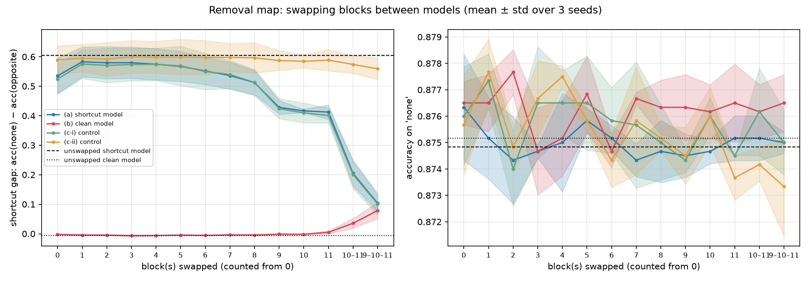

# SWAP REPORT: Phase 2 removal map (block swaps)

**Status: FINISHED.** All 168 cases ran: 3 seeds × 4 cases × 14 block sets. There were no crashes. The run was paused twice at Sonu's
request and resumed from saved cases each time. Swap numbers below are from `results/swap/seed{0,1,2}.json`, via the
tables `src/report.py` generated in [RESULTS.md](RESULTS.md). Cells are mean over 3 seeds (per-seed values in brackets).

**Gap** = acc(none) − acc(opposite), i.e. how much the misleading name hurts. In the unswapped models it is
**0.604** for the shortcut model (0.646/0.626/0.541) and **−0.006** for the clean model.

## 1. Which blocks remove the shortcut when swapped in from the clean twin? (case a)
- **No single block removes it.** Swapping in block 9, 10 or 11 alone cuts the gap to about **0.41–0.43**
  (block 9: 0.428, block 10: 0.416, block 11: 0.412), which removes roughly a third of it. Blocks 0–8 do much less:
  their gaps run from 0.512 (block 8) to 0.583 (block 1). Block 0 is a small exception at 0.535.
- **The last blocks together remove most of it.** Blocks 10–11 give a gap of **0.205** (0.167/0.184/0.263).
  Blocks 9–11 give **0.103** (0.075/0.093/0.142). That's about 83% of the gap gone, but **not all of it**.
- **Normal accuracy isn't hurt.** Accuracy on "none" stays at 0.874–0.876 in every case (a) swap.
  On "opposite" it rises from 0.270 to 0.772 with blocks 9–11.

## 2. Real removal or just breaking the model? (controls)
- **(c-ii) Blocks from a shortcut model of a different seed:** the shortcut stays. The gap is 0.559–0.588 for
  blocks 9, 10, 11, 10–11 and 9–11 (vs 0.604 unswapped), and accuracy on "none" is unchanged (0.873–0.876).
  So swapping in a different model's blocks doesn't by itself break anything. **The removal in (a) comes from the
  clean blocks, not from swapping as such.** This is real removal, not breakage.
- **(c-i) Blocks from a clean model of a different seed:** almost the same as (a). Blocks 9–11 give a gap of 0.101 and
  blocks 10–11 give 0.201. So any clean model's late blocks work; it doesn't have to be the matching twin.

## 3. The reverse: does putting shortcut blocks into a clean model create the shortcut? (case b)
- **Barely.** Single blocks give a gap of about 0 (−0.007 to 0.005 across blocks 0–11). Blocks 10–11 give 0.036, and blocks 9–11 give
  **0.079** (0.078/0.112/0.046), compared with 0.604 in the real shortcut model.
- **So the late blocks are needed but not enough.** Taking them out removes most of the shortcut, but adding them
  alone doesn't bring it back. The shortcut model's earlier parts (blocks 0–8 and/or embeddings) must also carry
  something the late blocks rely on, perhaps a "this is name A/B" signal. This matches the small effect of
  swapping block 0 in case (a). It's a guess, not tested yet.
- Side note, already checked: in seed 0, the (a) and (b) results for blocks 9–11 look almost identical in totals.
  I checked on CPU that these are different models: their weights differ and they disagree on 5% of reviews.
  The similar totals are a coincidence of two "half-and-half" models, not a bug.

## 4. Comparison with the logit lens
Reminder: our lens **layer L = output of block L−1**. So the lens flip at layers 10–12 is blocks 9–11.
- **Same region.** The lens says the flip happens in blocks 9–11, and swapping blocks 9–11 is what removes the
  shortcut. The lens pointed to the right place.
- **Different within that region.** In the lens "per-block drop" table (RESULTS.md, added after seeing results),
  blocks 11 and 9 do most of the flipping, while block 10 adds little. But in the swap map, block 10 removes as much
  as blocks 9 and 11 (gap 0.416 vs 0.428 / 0.412). So the block where the readout visibly flips isn't the
  only block whose weights matter for removal. This fits "where you find it isn't always where you fix it"
  (Hase et al.), on a small scale.
- **Eshuijs et al.** put the label heads in blocks 10–11. Swapping blocks 10–11 here removes about two-thirds of the
  gap (0.604 → 0.205); adding block 9 takes it to 0.103.

## Caveats
- **Nothing removes the shortcut fully.** Even blocks 9–11 leave a gap of 0.103 (0.142 in seed 2).
- **A swap replaces a whole block,** both attention and MLP. We don't yet know which part, or which heads, matter.
- **The right panel of the figure is zoomed in a lot** (y-axis 0.872–0.879). The wiggles there are tiny
  differences on 2,000 reviews, not real effects.

## What I'd suggest next (not started)
1. Split blocks 9–11 into attention vs MLP swaps, then single heads. That would compare directly with Eshuijs's label heads.
2. Find what blocks 0–8 contribute (case b): for example, swap the embeddings plus late blocks, or blocks 0–2 plus 9–11.

## Files
`src/swap.py`, `src/run_swap.py` (driver: offline, auto-report), `results/swap/seed*.json`, `figures/swap_map.png`,
`logs/run_swap.log`, `logs/swap.log`. Re-run: `.venv\Scripts\python src\run_swap.py` (skips finished cases).
